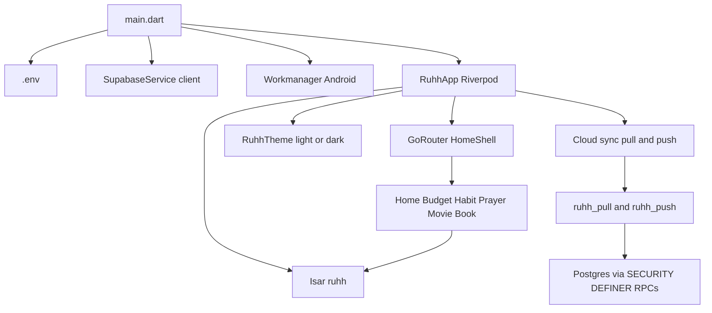

# RUHH architecture (Phase 0 audit)

**Date:** 16 November 2026
**Tree audited:** `main` at `71cd0553` ("Release v1.0.34 after movie_categories Supabase migration on remote."), version `1.0.34+35` in `ruhh/pubspec.yaml`.
**Method:** read-only inspection of this repository. No application code was changed. The production Supabase project was not queried. Database facts below are from SQL and Dart in the repo; anything inferred is marked.

This document is the architecture and feature inventory. Schema detail is in `docs/RUHH_DATABASE_DESIGN.md`. Visual tokens are in `docs/RUHH_DESIGN_SYSTEM.md`. The phase plan is in `docs/RUHH_IMPLEMENTATION_ROADMAP.md`.

## 1. What this repository is

RUHH is a Flutter application. The shipped app lives in `ruhh/`. A path dependency, `UI/`, is the `neubrutalism_ui` package. `ruhh/lib` does not import it (no `package:neubrutalism_ui` imports). The root `README.md` still mentions sibling `Budget-Tracker/` and `Habit-Tracker/` folders; they are not in this checkout.

### Cashew lineage

This Git history is a fork that once contained [jameskokoska/Cashew](https://github.com/jameskokoska/Cashew). Commit `77007b00` ("Replace Cashew fork with RUHH unified Flutter life tracker") deleted that tree: **1,074 files changed, 23,328 insertions, 195,337 deletions**. The Cashew parent (`77007b00^`) had a root `budget/` app (245 `.dart` files) plus `promotional/` and `scripts/`.

Of the files present before that commit, only `.gitignore` and `README.md` still exist, and `README.md` was rewritten. **No Cashew source file remains.** The current `ruhh/lib` tree is RUHH-specific: about 202 non-generated Dart files, about 34,400 lines, plus Isar `*.g.dart` outputs.

What survives of Cashew is a **domain shape inside Budget**, rewritten under `ruhh/lib/features/budget/` and `ruhh/lib/core/data/models/budget_extras_local.dart`: wallets, categories, transactions, schedules, savings/debt objectives, category limits. The only name left in source is an unused alias:

```129:131:ruhh/lib/features/budget/budget_defaults.dart
/// Legacy export for files still importing cashew list.
typedef BudgetDefaultCategory = BudgetDefaultCategorySeed;
const cashewDefaultCategories = indianDefaultCategories;
```

`cashewDefaultCategories` has no callers. Seeding uses `indianDefaultCategories`. Currency handling in the ledger is INR-oriented (`ruhh/lib/features/budget/ledger/budget_inr.dart`).

**Proportion:** upstream Cashew code in the working tree is effectively **zero**. The budget feature is a RUHH rewrite that kept Cashew-like concepts. Habit, prayer, movies, books, home, sync, and the portfolio visual language are RUHH-specific and were not in that Cashew tree.

### Stack (from `ruhh/pubspec.yaml`)

| Concern | Choice |
| --- | --- |
| UI | Flutter, Material 3 (`RuhhTheme` in `ruhh/lib/core/theme/ruhh_theme.dart`) |
| Language | Dart SDK `^3.12.2` |
| State | `flutter_riverpod` 2.x, mostly hand-written providers (the `riverpod_annotation` dependency is declared; feature code uses classic `Provider` / `NotifierProvider`) |
| Navigation | `go_router` 14, `StatefulShellRoute.indexedStack` |
| Local DB | Isar 3 (`isar`, `isar_flutter_libs`) |
| Cloud | `supabase_flutter` 2.x, custom RPCs, anon key from `.env` |
| Preferences | `shared_preferences` |
| Fonts | `google_fonts` (DM Sans, Outfit) plus bundled Phosphor |
| Charts | `fl_chart` |
| Motion | `flutter_staggered_animations`, `confetti`; `flutter_animate`, `lottie`, and `shimmer` are dependencies with no `ruhh/lib` imports |
| Platform extras | `flutter_local_notifications`, `workmanager`, `flutter_overlay_window`, `home_widget`, `permission_handler` |

There is **no CI workflow on `main`** for the app. The only workflows in this checkout are `UI/.github/workflows/`, for the unused UI package. An unmerged branch, `origin/feature/security-session-agent`, adds `.github/workflows/ruhh-ci.yml` (Flutter 3.44.8, Deno, disposable local Supabase). That workflow is not on `main`.

`ruhh/UAT.md` (dated 2026-09-19) describes 6 budget tabs, 6 habit tabs, and 4 movie tabs. The current shells are 5, 3, and 2. Treat `UAT.md` as a historical note, not a description of 1.0.34.

## 2. Process and startup

`ruhh/lib/main.dart`:

1. `WidgetsFlutterBinding.ensureInitialized()`
2. `dotenv.load(fileName: '.env')` — `.env` is a Flutter asset (`pubspec.yaml`) and is gitignored. `ruhh/.env.example` holds placeholders only (URL, anon key placeholder, TMDB key placeholder).
3. `SupabaseService.initialize()` — builds a Supabase client when URL and anon key look usable (`ruhh/lib/core/services/supabase_service.dart`). This is not Supabase Auth sign-in.
4. `initRuhhWorkmanager()` — Android periodic notification reschedule (`ruhh/lib/core/services/ruhh_workmanager.dart`).
5. `runApp(ProviderScope(child: RuhhApp()))`.

Isar is not opened in `main()`. `isarProvider` opens it on first use (`ruhh/lib/core/data/isar_service.dart`, database name `ruhh` under the app documents directory).

`RuhhApp` then:

- Builds `GoRouter` once and binds notification taps (`NotificationNavigation.bindRouter`).
- Listens to auth and settings to refresh redirects.
- Watches `cloudSyncLifecycleProvider` (periodic sync while logged in).
- On Android, after login, runs `SmartNotificationScheduler.refreshAll()` and `HomeWidgetService.sync`.
- Applies `RuhhTheme.light()` / `dark()` from `settings.darkMode` (default dark).
- Paints `NBGlassBackground` (desk grid) behind the router.
- On resume: sync and streak alarm. On pause: `flushCloudSyncToServer`.

Two other entry points in the same file: `overlayMain` (quick-action overlay, dark theme, its own Isar) and `overlayTriggerMain` (shows the overlay and exits).



## 3. Navigation

Defined in `ruhh/lib/core/routing/app_router.dart`. Redirects: splash while auth or settings load; logged out users go to `/auth/welcome`; incomplete onboarding goes to `/onboarding`; a signed-in user hitting splash or auth goes to `/home`.

| Path | Screen |
| --- | --- |
| `/splash` | `SplashPage` |
| `/auth/welcome`, `/auth/login`, `/auth/signup` | Username + PIN auth |
| `/onboarding`, `/onboarding/notifications` | Module picker, notification permission |
| `/settings`, `/settings/notifications`, `/settings/overlay` | Settings (root navigator) |
| `/home` | `HomePage` |
| `/analytics` | `AnalyticsPage` — registered, **no UI navigation found** to this path |
| `/budget`, `/budget/add`, `/budget/edit/:id` | Budget shell and transaction editor (`?tab` 0–4) |
| `/habit`, `/habit/new`, `/habit/edit/:id`, `/habit/detail/:id` | Habit shell (`?tab` 0–2) |
| `/prayer`, `/prayer/stats` | Prayer shell (`?tab` 0–2). `/prayer/stats` redirects to tab 2 |
| `/movie` and movie add/edit/categories/detail | Movie shell (`?tab` 0–1) |
| `/book` and book add/edit | Book shell (`?tab` 0–1) |

`HomeShell` (`ruhh/lib/features/home/home_shell.dart`) is a six-destination icon bar: Home, Budget (wallet icon), Habit, Prayer, Movie, Book. The widget is `RuhhFloatingNav`. There is no room in that bar for a seventh product area without removing or nesting something.

Habit settings and prayer settings are pushed with `Navigator` rather than `go_router`.

## 4. Modules and their state

"Shipped" means a route in `app_router.dart` reaches the screen. "Present but unreachable" means the Dart exists and nothing imports the page.

### Auth — shipped

`ruhh/lib/features/auth/`. Username (minimum 3 characters) and a 6-digit PIN. The PIN is stored as SHA-256 of `salt:pin` on `UserLocal` (`pinHash`, `pinSalt`). Cloud registration calls `ruhh_register_user`. Login can copy a profile with `ruhh_fetch_auth_profile`, which returns the hash and salt. The session key in SharedPreferences is the username only (`ruhh_session_username` in `ruhh/lib/core/session/session_providers.dart`). There is no email, no OAuth, and no Supabase Auth JWT. If the client is missing, signup can proceed locally (`UsernameAvailability.offlineAvailable`).

### Onboarding — shipped, copy is stale

`ruhh/lib/features/onboarding/onboarding_page.dart` says habit, prayer, and movie are always on, and budget is optional. Books are already a primary tab and are not mentioned. Welcome copy in `ruhh/lib/features/auth/welcome_auth_page.dart` also omits books.

### Home — shipped

`ruhh/lib/features/home/home_page.dart`. Title text is **"Home"**. Regions:

- Bell and avatar, both pushing `/settings`.
- `HomeDayHeroSection` — time-of-day greeting and a short readout of habits, prayer, and optional budget (`ruhh/lib/features/home/widgets/home_feed_insights.dart`).
- "Today" — two compact scores (habits due, prayers 0–5).
- "Insights & trends" — `HomeFeedInsights`, tappable cards built from real repositories.
- "Modules" — streak, watchlist, reading list, optional budget month.

There is **no screen, string, or route named My Space or living room** anywhere under `ruhh/lib`. The closest metaphor in code is the desk grid behind every page (`NBGlassBackground`) and an unrouted page titled around "My island" (`ruhh/lib/features/island/`).

`home_redesign_sections.dart` (hero dials, focus card) is not imported. `AnalyticsPage` is a second, thinner insights list and is not linked from Home.

### Budget — shipped, with orphan screens

Shell tabs in `ruhh/lib/features/budget/budget_page.dart`: **Home, List, Income, Trends, Manage**. Add/edit transaction is routed. Live home shows the pie and `BudgetCapsSection`. Manage covers categories, salary, and limits.

Data model (Isar): `TransactionLocal`, `WalletLocal`, `CategoryLocal`, `BudgetPeriodLocal`, `ObjectiveLocal` (kind `savings` or `debt`), `CategoryBudgetLimitLocal`, `StandingSalaryLocal`. Math is in `ruhh/lib/features/budget/ledger/`. A salary engine generates income rows (`budget_salary_engine.dart`).

`BudgetObjectivesPage`, `BudgetBudgetsPage`, `BudgetAccountsPage`, and `BudgetUpcomingPage` are not referenced by the router or the shell. `BudgetGoalsSection` is only used by those orphan pages. Objective rows still exist, still sync, and can still be linked from a transaction (`objectiveRemoteId`), but the user cannot open the goals UI from the shipped tabs.

### Habit — shipped and the strongest engine in the app

Shell tabs: **Today, Habits, Stats** (`habit_page.dart`). Form, detail, and a settings page (imperative push).

`HabitLocal` supports positive, negative, and quantitative habits; intervals daily, weekly, monthly, weekdays, and every X days/weeks/months; weekday lists, month days, a start anchor, target per day, increment, unit, description, reminders JSON, vacations JSON, archive, sort. Completions are `HabitCompletionLocal` (synced). `HabitLogLocal` is a per-day status view (pending, completed, missed, excused) with a unique `(dateKey, habitRemoteId)` index; it is derived for the UI and is not a cloud table.

Streaks, longest streak, scheduling, and completion rate live in `habit_logic.dart`, `tracker/habit_calculations.dart`, and `tracker/habit_scheduling.dart`. Today being incomplete does not immediately zero a streak: the daily path steps back one day before breaking (`HabitLogic.currentStreak`). Milestone celebrations at 7, 30, 100, and 365 days are UI, not an XP ledger (`streakMilestone` in `habit_calculations.dart`). Tests cover a worked example in `ruhh/test/habit_calculations_test.dart`.

This is the module to extend. It is not a stub.

### Prayer — shipped

Shell tabs: **Today, Calendar, Stats**. Times can come from Aladhan (`aladhan_prayer_service.dart`) and from the `adhan` package. A daily ayah path exists (`telawa_service.dart`). The screen the user actually uses is the daily tracker: `DailyPrayerLogLocal` with per-prayer status `unmarked`, `prayed`, `missed`, `excused` (`prayer_domain.dart`, `prayer_home_page.dart`). Streaks are calculated in `prayer_calculations.dart`. Excused days exist.

A second, older model is still in the repository: `PrayerLogLocal` plus `PrayerRepository.setStatus`, which applies SharedPreferences points (`withGroup` +2, `onTimeAlone` +1, `lateAlone` −2, `missed` −4). A search of `ruhh/lib` found **no caller** of `setStatus` or `points()`. `prayer_stats_widgets.dart` and `prayer_monthly_grid.dart` are not imported. Cloud sync maps the live tracker onto the older status enum when it writes `prayer_logs` (`supabase_sync_service.dart`: prayed → `onTimeAlone`, excused → `qadha`, unmarked skipped).

So the shipped prayer experience does not show a score. A punitive points function is leftover code. That matters for the vision: do not promote it into the central XP engine.

### Movies — shipped

Shell tabs: **Watchlist, Watched**. Categories, manual add, and TMDB detail (`/movie/detail/:mediaType/:tmdbId`) are routed. `TmdbService` needs the TMDB key from `.env`. `MovieHomePage`, `MovieDiscoverPage`, `MovieLibraryPage`, and `MovieSearchPage` are not referenced outside their own files.

### Books — shipped

Shell tabs: **Want to read, Read**. Search uses Open Library (`open_library_service.dart`). Records sync (`books` table, migration `20261112120000_books_sync.sql`). Onboarding copy does not mention the module.

### Settings — shipped

`settings_controller.dart`: budget on/off, onboarding flag, dark mode (default **true**), and notification toggles for budget, habit, prayer, movie, streak protection, and recommendations. Dark mode and notify flags are SharedPreferences on the device. Budget enabled and onboarding complete also round-trip inside `users.preferences`. Cloud backup and CSV file backup are offered from the settings page (`ruhh_file_backup_service.dart`).

### Focus, Todos, Island — implemented and unreachable

| Module | What the code does | Reachable? |
| --- | --- | --- |
| `features/focus/` | A timer persisted as `FocusSessionLocal`. `FocusPage` ties the session to the first habit if one exists. | No route, no imports of `FocusPage` |
| `features/todo/` | `TodoLocal` CRUD, optional reminder scheduling, home-widget JSON via `TodosWidgetService` | No route, no imports of `TodosPage` |
| `features/island/` | A coin shop. `IslandLedger` awards 10 per habit check, 1 per focus minute (cap 60/day), 25 per perfect day, 4 per completed todo, plus lump sums at streak steps 7/30/100/365 (30/150/600/2500). State is SharedPreferences (`island_owned_*`, `island_spent_*`, `island_name_*`). | No route, no imports of `IslandPage` |

Island coins are a second, hardcoded currency. `IslandLedger.compute` is a pure function: habit checks, capped focus minutes, perfect days, and todos are counted from history, but the streak bonuses (30 / 150 / 600 / 2500 at current streaks of 7 / 30 / 100 / 365) are added per habit from the **current** streak only (`island_ledger.dart`). They are not stored as one-time events. When a streak drops, those coins leave the computed total. `IslandNotifier` persists `spent` and owned pieces, not `earned`, and `balance` clamps at zero (`island_controller.dart`). Nothing is synced. This must not become the XP engine.

There is **no workout or fitness module**. The only fitness hook is a habit icon named `fitness` in `habit_appearance.dart`.

### What a life-progression system would look for, and what exists

| Idea | In 1.0.34 |
| --- | --- |
| Life domains | No. `prayer_domain.dart` is the prayer day model, not a life-domain table. |
| Lifetime goals, milestones, projects, quests | No. |
| Central XP, levels, titles, achievements, seasons | No. |
| Habit streaks and best streak | Yes, per habit, with history. |
| Prayer streaks | Yes, on the daily tracker. |
| Budget "goals" | Savings/debt `ObjectiveLocal` only, and the management UI is unreachable. |
| Spendable points | Island coins (unreachable) and prayer points (no callers). |

## 5. State management

Repositories are `FutureProvider`s that watch `isarProvider` and `currentUserProvider` (see `budgetRepositoryProvider` in `budget_repository.dart`). Lists that should live-update use `StreamProvider` (`habitLogViewsProvider`, `dailyPrayerLogsProvider`). Auth and settings are `Notifier`s. Focus and island use `StateNotifier`.

Writes call `notifyLocalDataChanged()` (`local_data_sync.dart`), which schedules a debounced cloud push unless the caller is the overlay isolate. Module screens also bump `*RefreshProvider` counters.

`cloudSyncLifecycleProvider` (`cloud_sync.dart`) runs a full sync about every 45 seconds while a user is logged in, with a 400 ms debounce on local edits and a retry around 12 seconds after failure.

## 6. Local storage and sync (summary)

Detail, including columns and risks, is in `docs/RUHH_DATABASE_DESIGN.md`.

- **Source of truth on the device:** Isar. Nineteen collections are opened in `isar_service.dart`. There are no Isar links; relationships are string `remoteId`s.
- **Cloud:** one JSON snapshot per user through `ruhh_pull` / `ruhh_push`. The client sends the stored PIN hash as the credential. The server verifies it inside `SECURITY DEFINER` functions. RLS is enabled and table privileges are revoked; there are **no** `CREATE POLICY` statements. Direct table access is not how the app reads data.
- **Conflict policy:** last successful push wins. The client pushes a full snapshot, then pulls, then upserts. Omitted ids are deleted on the server when the payload actually contains entity arrays (`payload_has_entities` in `20260921140000_ruhh_push_skip_empty_wipe.sql` and the latest function body in `20261112150000_movie_categories_sync.sql`). There is no per-field merge and no device vector clock.
- **Wipe guards:** an empty local database pulls before it pushes. Import refuses to delete local rows when the device has rows and the cloud count is 0 (`supabase_sync_service.dart`). A file import wipes local Isar for that user first.
- **Not in Postgres:** wallets, categories, budget periods, standing salary, habit logs, daily prayer logs, prayer time cache, todos, focus sessions, island state, prayer points, notification toggles, dark mode. File backup (`ruhh_backup_codec.dart`) carries several of those. A new phone that only cloud-syncs will not restore them.
- **Known column drift:** the client sends habit `schedule_month_days` and `schedule_start_date_key`, and category-limit `month_key`, `rollover_enabled`, and `category_remote_id`. Those columns are not in the SQL migrations (confirmed by search). `to_jsonb` on pull will not return them, so a cloud round-trip drops them.

## 7. Notifications, overlay, widgets

- Channels in `notification_channels.dart`: prayer reminders, habit reminders, streak protection, budget alerts, recommendations, system.
- `RescheduleAllNotifications` rebuilds prayer windows, habit reminders, a streak alarm (notification id 1004), and recommendations. Workmanager repeats this daily on Android.
- Settings toggles exist. Copy is functional, not guilt-based, but there is no weekly summary, no goal-deadline channel, and no achievement channel, because those objects do not exist.
- Android overlay (`overlay/quick_action_stepper.dart`) can log budget, habit, prayer, and movie. It does not know about books.
- Home screen widget (`home_widget_service.dart`) publishes a habit summary. `TodosWidgetService` writes pending todos at the same Android provider name even though the todo screen is unreachable.

## 8. Grok Bot

**On `main` (this tree): there is no Grok integration.** A search for `grok`, `xai`, and agent clients under `ruhh/` on `main` finds nothing. No Edge Function directory exists on `main`.

**On `origin/feature/security-session-agent` (not merged, 14 commits ahead of the merge-base `2eb2bc78`, and `main` is 4 commits ahead of that base):** a design for connecting Grok exists and is explicitly **not enabled**.

From `ruhh/docs/AGENT_INTEGRATION.md` on that branch:

- Endpoint `POST /functions/v1/ruhh-agent` with a dedicated bearer `ruhh_agent_<64 hex>`, not the service-role key.
- Read ops: `budget.summary`, `budget.list_transactions`, `budget.upcoming`, `budget.objectives`, `budget.category_limits`, `habit.list`, `habit.completions`, `prayer.summary`, `movie.list`.
- Write ops, behind `RUHH_AGENT_WRITES` defaulting off: `tx.add`, `habit.mark_done`, `prayer.set_status`, `movie.add_watchlist` enqueue into an inbox the phone applies; `tx.edit`, `tx.delete`, `movie.delete` become proposals. The agent cannot approve. The user approves in **Settings → Agent approvals** with a session token. Proposals expire in 15 minutes.
- Books, goals, quests, and XP are not operations. The branch does not contain the books or movie-category work that landed on `main` after the merge-base (`e695f74f`, `bdc37f65`, `71cd0553`).

That branch also replaces PIN-hash sync with server sessions (`ruhh_login`, `ruhh_pull_v2`, `ruhh_push_v2`) while leaving v1 RPCs in place until a pending script `supabase/pending/S2_retire_legacy_auth.sql`. Its own `SECURITY_ROLLOUT.md` states that nothing on the branch has been applied to production ref `gmmfimwumtbneynsyimz`. This audit did not connect to that project, so that statement is the branch's claim, not a live confirmation.

The branch is the right *shape* for a later Grok phase (credential, read vs write, human approval, idempotent `request_id`). It is not production, and it cannot be merged cleanly on top of 1.0.34 without reconciling books, movie categories, and the four `main` commits it lacks.

## 9. Accessibility and locale (current)

- `Semantics` appears in `movie_tracker_card.dart`. It is not a system-wide practice.
- No `MediaQuery.disableAnimations` / reduced-motion branch was found.
- No `flutter_localizations` / ARB catalogs. `intl` is used for dates and INR formatting.
- Dates are local `DateTime`s. Timezone plugins are dependencies (`timezone`, `flutter_timezone`) for notifications.
- Layout: `NBLayout.maxContentWidth` is 720, so a wide window does not stretch cards forever, but the product is designed as a phone (`home_shell` bottom nav, overlay Android-only).
- `ruhh/UAT.md` records a Windows desktop run. Android is the platform with overlay, workmanager, and the home widget.

## 10. Verification

Results of `flutter analyze` and `flutter test` on this branch are recorded at the bottom of `docs/RUHH_IMPLEMENTATION_ROADMAP.md` under "Phase 0 verification", after the commands were actually run.
