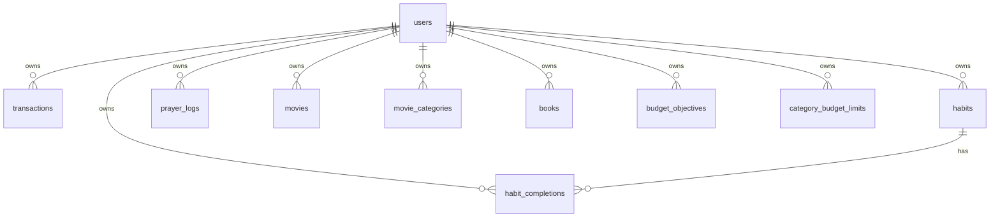

# RUHH database design (Phase 0 audit)

**Date:** 16 November 2026
**Scope:** schema as defined in this repository. The production project ref `gmmfimwumtbneynsyimz` is named in `ruhh/README.md`, `ruhh/RUN_AND_INSTALL.md`, and `ruhh/.env.example`. **This audit did not connect to it, did not run migrations, and did not read live rows.** If production has been edited outside these files, that drift is invisible here.

**Sources:**

- `ruhh/supabase/migrations/*.sql` (applied in filename order)
- `ruhh/supabase/schema.sql` (a pointer; the migrations are the schema)
- `ruhh/supabase/scripts/wipe_all_user_data.sql` (destructive admin truncate; not part of app startup)
- Isar models in `ruhh/lib/core/data/models/`
- Sync in `ruhh/lib/core/services/supabase_sync_service.dart`, `cloud_sync.dart`, `supabase_service.dart`

`ruhh/supabase/config.toml` sets `project_id = "ruhh"`. That is the local CLI name, not the hosted ref.

## 1. How authority is split

| Layer | Role |
| --- | --- |
| Isar on the device | What the UI reads and writes. Opens lazily. Nineteen collections. |
| SharedPreferences | Session username, theme, notification flags, prayer location and leftover points, island shop. |
| Postgres | Backup and multi-device copy of a subset of entities, through two RPCs. |
| CSV file backup | A wider snapshot than Postgres, including several local-only collections (`ruhh_backup_codec.dart`). |

There is no sync metadata on Isar rows (no `dirty`, no `deletedAt`, no vector clock). Identity for synced rows is a client-generated UUID in `remoteId` / SQL `id`.

## 2. Migration history

| File | What it does |
| --- | --- |
| `20260318120000_ruhh_init.sql` | `users`, `transactions`, `habits`, `habit_completions`, `prayer_logs`, `movies`. RLS enabled, privileges revoked, no policies. RPCs: `ruhh_verify_user`, `ruhh_is_username_available`, `ruhh_register_user`, `ruhh_fetch_auth_profile`, `ruhh_pull`, `ruhh_push`. |
| `20260319103000_user_preferences.sql` | `users.preferences jsonb`. Pull/push include it. |
| `20260319120000_budget_goals_scheduled.sql` | `budget_objectives`, `category_budget_limits`. Transaction columns for title, schedule, recurrence, `objective_remote_id`. |
| `20260320120000_ruhh_transaction_delete_sync.sql` | Push deletes cloud transactions missing from the payload. |
| `20260919120000_habit_movie_sync_extended.sql` | Habit columns for icon, kind, interval, schedule, vacations, reminders. Movie columns for backdrop, ratings, review, liked, favorite, `watched_at`. |
| `20260920120000_movie_tracker_sync.sql` | Movie `category_remote_id`, `priority`, `tracker_note`. |
| `20260920213000_ruhh_push_per_entity_reconcile.sql` | Reconcile-delete only when that entity's array is non-empty. |
| `20260920220000_ruhh_push_upsert_transactions_only.sql` | Briefly stops deleting transactions on push. Superseded. |
| `20260921120000_ruhh_sync_reconcile.sql` | Transaction `ledger_type`, `category_remote_id`, `is_auto_generated`. Restores reconcile-delete across entity types. |
| `20260921140000_ruhh_push_skip_empty_wipe.sql` | Skips every reconcile-delete when the payload has no entity arrays (`payload_has_entities`). |
| `20260922110000_color_value_bigint.sql` | `habits.color_value` and `budget_objectives.color_value` become `bigint` (Flutter color ints do not fit in Postgres `int`). |
| `20261112120000_books_sync.sql` | `books` table. Pull/push include books. |
| `20261112150000_movie_categories_sync.sql` | `movie_categories` table. This file contains the latest `ruhh_pull` and `ruhh_push` bodies. |

The unmerged branch `origin/feature/security-session-agent` adds further migrations (`20261022120000` through `20261022170000`: sessions, agent inbox, agent API, proposals, legacy rate limits). They are **not** in `main` and, according to that branch's `SECURITY_ROLLOUT.md`, have not been applied to production. They are not part of the schema below.

## 3. Postgres tables (as of the latest migration on `main`)

Every user-owned table has `user_id uuid not null references public.users(id) on delete cascade`, except `users` itself. RLS is enabled and `REVOKE ALL` is applied to `anon` and `authenticated`. No policies are created. Access is intended only through `SECURITY DEFINER` RPCs that check the PIN hash.

### `users`

| Column | Notes |
| --- | --- |
| `id uuid` PK | Client-generated. Not `auth.users`. |
| `username text` unique | Also indexed `lower(username)`. |
| `pin_hash text`, `pin_salt text` | SHA-256 of `salt:pin`, same value the client stores and sends. |
| `created_at timestamptz` | |
| `preferences jsonb` | Onboarding complete and budget enabled. |

### `transactions`

`id`, `user_id`, `amount numeric`, `is_income boolean`, `category text`, `account text` default `'Cash'`, `note`, `occurred_at`, `updated_at`, `title`, `schedule_type` default `'normal'`, `paid` default true, `recurrence` default `'none'`, `period_length` default 1, `recurrence_end`, `objective_remote_id text` (no FK), `ledger_type`, `category_remote_id text`, `is_auto_generated boolean`.

No index beyond the primary key was added in these migrations.

### `habits`

`id`, `user_id`, `name`, `color_value bigint`, `frequency text`, `target_per_day int`, `reminder_minute int`, `archived`, `updated_at`, `icon`, `kind`, `interval`, `target_frequency`, `schedule_weekdays jsonb`, `schedule_every`, `schedule_unit`, `increment_amount`, `unit_label`, `description`, `rest_days jsonb`, `vacations_json text`, `reminders_json text`, `sort_order`, `created_at`.

**Not columns, but sent by the client:** `schedule_month_days`, `schedule_start_date_key` (`supabase_sync_service.dart` habit JSON). A pull rebuilds the habit from `to_jsonb`, so those two fields come back empty.

### `habit_completions`

`id`, `habit_id` FK → `habits` on delete cascade, `user_id`, `day date`, `value double precision`. Unique `(habit_id, day)`.

### `prayer_logs`

`id`, `user_id`, `day date`, `prayer text`, `status text`. Unique `(user_id, day, prayer)`.

This is the cloud shape. The UI's source of truth is `DailyPrayerLogLocal` (one row per day, five statuses). Sync flattens and rehydrates. See architecture doc.

### `movies`

`id`, `user_id`, `tmdb_id int`, `title`, `poster_path`, `media_type` default `'movie'`, `watch_status`, `overview`, `updated_at`, `backdrop_path`, `release_date`, `vote_average`, `user_rating`, `user_review`, `liked`, `favorite`, `watched_at`, `category_remote_id`, `priority`, `tracker_note`.

`category_remote_id` is text, not a foreign key to `movie_categories`.

### `movie_categories`

`id`, `user_id`, `name`, `color_value bigint`, `emoji`, `is_custom`, `is_archived`, `sort_order`, `updated_at`.

### `books`

`id`, `user_id`, `open_library_key`, `title`, `author`, `cover_url`, `first_publish_year`, `description`, `status`, `page_count`, `user_rating`, `note`, `finished_at`, `updated_at`.

`BookLocal.addedAt` is local. The cloud row only has `updated_at`.

### `budget_objectives`

`id`, `user_id`, `name`, `target_amount numeric`, `kind text` default `'savings'`, `wallet_name text`, `color_value bigint`, `pinned`, `archived`, `end_date`, `sort_order`, `updated_at`.

These are money goals (savings or debt), not life goals. `wallet_name` is a string, not a FK, and wallets themselves are not a cloud table.

### `category_budget_limits`

`id`, `user_id`, `budget_remote_id text`, `category_name text`, `limit_amount numeric`, `updated_at`.

**Not columns, but sent by the client:** `month_key`, `rollover_enabled`, `category_remote_id` (`_categoryLimitJson` in `supabase_sync_service.dart`). A pull cannot restore them.

String links that are **not** foreign keys: `transactions.objective_remote_id`, `transactions.category_remote_id`, `transactions.account` (wallet name), `movies.category_remote_id`, `category_budget_limits.budget_remote_id`, `budget_objectives.wallet_name`.

## 4. RPCs on `main`

Granted to `anon` and `authenticated` by the init migration (later migrations replace function bodies in place):

| Function | Behavior |
| --- | --- |
| `ruhh_verify_user(uuid, text)` | True when `users.pin_hash` equals the argument. |
| `ruhh_is_username_available(text)` | Username check. |
| `ruhh_register_user(...)` | Inserts a user with the client-supplied id, username, hash, and salt. |
| `ruhh_fetch_auth_profile(text)` | Returns `id`, `username`, `pin_hash`, `pin_salt` for a username. This is how a new device learns the hash. |
| `ruhh_pull(uuid, text)` | Verifies the hash, returns one JSON object of preferences and every synced array. |
| `ruhh_push(uuid, text, jsonb)` | Verifies the hash, replaces `preferences` when present, deletes missing ids when `payload_has_entities` is true, then upserts each array. |

`ruhh_push` trusts the client for row contents and for which ids still exist. A partial snapshot that still contains at least one entity array can delete every omitted row of every reconciled type. The empty-payload guard only helps when **all** entity arrays are absent or empty.

## 5. Isar collections

Opened in `ruhh/lib/core/data/isar_service.dart`. No `@Backlink` relationships. `remoteId` is the UUID shared with Postgres where the entity syncs.

| Collection | File | Cloud? |
| --- | --- | --- |
| `UserLocal` | `user_local.dart` | `users` + `preferences`. Unique index on `username`. |
| `TransactionLocal` | `transaction_local.dart` | `transactions`. Index on `monthKey` (local). |
| `HabitLocal` | `habit_local.dart` | `habits`, minus the two schedule fields noted above. |
| `HabitCompletionLocal` | `habit_local.dart` | `habit_completions`. |
| `HabitLogLocal` | `habit_local.dart` | No. Rebuilt from completions. Unique `(dateKey, habitRemoteId)`. |
| `PrayerLogLocal` | `prayer_local.dart` | Written out from the daily tracker as `prayer_logs`. The setter that edits this collection directly has no UI caller. |
| `DailyPrayerLogLocal` | `prayer_local.dart` | No table. Unique `(dateKey, userId)`. This is what Prayer and Home display. |
| `PrayerTimeLocal` | `prayer_local.dart` | No. Cached times. |
| `MovieLocal` | `movie_local.dart` | `movies`. |
| `MovieCategoryLocal` | `movie_category_local.dart` | `movie_categories`. |
| `BookLocal` | `book_local.dart` | `books`. |
| `WalletLocal` | `budget_extras_local.dart` | No. File backup only. |
| `CategoryLocal` | `budget_extras_local.dart` | No. File backup only. |
| `BudgetPeriodLocal` | `budget_extras_local.dart` | No. File backup only. |
| `ObjectiveLocal` | `budget_extras_local.dart` | `budget_objectives`. |
| `CategoryBudgetLimitLocal` | `budget_extras_local.dart` | Partial. Month, rollover, and category id are local-only. |
| `StandingSalaryLocal` | `budget_extras_local.dart` | No. No `remoteId`. File backup only. |
| `TodoLocal` | `todo_local.dart` | No. |
| `FocusSessionLocal` | `focus_session_local.dart` | No. |

`isar_service.dart` can clear the movie collections when it decides they are corrupt, and it records `ruhh_movie_isar_repaired` in SharedPreferences. That is a local data-loss path.

## 6. SharedPreferences keys

| Key | File |
| --- | --- |
| `ruhh_session_username` | `session_providers.dart`, `auth_controller.dart` |
| `ruhh_movie_isar_repaired` | `isar_service.dart` |
| `dark_mode`, `theme_glass_v2`, `notify_*`, legacy `mod_budget`, `onboarding_done` | `settings_controller.dart` |
| `notif_streak_minute_of_day` | `notification_prefs.dart` |
| `notif_permission_asked_v1`, `notif_banner_dismissed_v1` | `notification_permissions.dart` |
| `prayer_lat_*`, `prayer_lng_*`, `prayer_points_*`, `prayer_streak_*`, `prayer_group_pct_*`, and related per-user keys | `prayer_repository.dart` |
| `island_owned_*`, `island_spent_*`, `island_name_*` | `island_controller.dart` |

No `flutter_secure_storage` and no Hive usage under `ruhh/lib`. The PIN hash sits in Isar.

## 7. Sync protocol (client)

`SupabaseSyncService.syncUser` in `supabase_sync_service.dart`:

1. Count local synced entities.
2. If the device is empty: pull first, import **without** local delete-reconcile, and only push if that pull succeeded. An empty device must not overwrite the cloud.
3. If the device is not empty: push the full payload, pull, import. Local delete-reconcile is turned off when the device has rows and the remote count is 0.
4. After import, rebuild `HabitLogLocal` from completions and `DailyPrayerLogLocal` from prayer rows.

`pushUserChanges` pushes only. If the local synced count is 0 it delegates to the full sync so it cannot blank the server.

Triggers (`cloud_sync.dart`, `local_data_sync.dart`, `auth_controller.dart`):

- Login and session restore schedule a full sync.
- Logged-in periodic full sync, about 45 seconds.
- Repository writes call `notifyLocalDataChanged()` → debounced push (~400 ms). The overlay isolate does not.
- Failure retries in about 12 seconds.

**Conflict handling:** none beyond last-write-wins on the same UUID. Two phones editing the same habit will each push a whole snapshot; the later push deletes whatever the earlier phone still had that this phone did not send.

## 8. Risks (schema and sync)

These are properties of the code, not a live incident report.

1. **The PIN hash is the cloud password.** `ruhh_fetch_auth_profile` returns it. `ruhh_pull` and `ruhh_push` accept it. Anyone who can call the anon API with a leaked hash can read and replace that user's backup. The hash is also in Isar and is sent on every sync (`cloud_sync.dart` passes `user.pinHash`). The session does not re-prompt for the PIN.
2. **RLS without policies** means safety is exactly equal to the RPCs. A new table granted to `anon` by mistake would be wide open. New progression tables have to follow the same revoke-and-RPC pattern, or move to the session model on the unmerged branch. Doing neither is not acceptable.
3. **Snapshot delete.** A non-empty but incomplete push deletes missing rows. The guards stop an empty local database and an all-empty payload. They do not stop a buggy exporter that sends habits and omits transactions.
4. **Schema drift already drops data** on cloud round-trip: habit month-days and schedule anchor; category-limit month, rollover, and category id. Wallets, categories, periods, and standing salary never leave the device except via file backup. A "new phone" restore from cloud is a partial restore.
5. **Two prayer representations.** Tracker rows and `prayer_logs` are lossy translations (`excused` becomes `qadha`, every `prayed` becomes `onTimeAlone`). Building XP on `prayer_logs.status` would misread the user's actual marks.
6. **No idempotency key for domain events.** Completing a habit twice is safe at the data layer because of `unique (habit_id, day)`, but there is no event log. A future XP award cannot be deduplicated by the current schema.
7. **File import** purges local user data before applying the file (`_purgeAllUserLocalData`). A bad file is destructive.
8. **`wipe_all_user_data.sql`** truncates `users` and cascades. It is an admin script. It must never be part of a feature migration.
9. **Color type** was already migrated from `int` to `bigint` after a production mismatch (`20260922110000`). New color columns should be `bigint` from the start.
10. **Objectives are the wrong noun** for life goals. Reusing `budget_objectives` for "become a person who…" would mix money amounts, wallet names, and life outcomes in one table and one sync array.

## 9. What a later schema phase has to respect

Not designed here, only constrained:

- Add tables. Do not rename or overload `budget_objectives`, `habits`, or `prayer_logs`.
- Every new synced entity needs a client UUID, a `user_id` FK, `updated_at`, inclusion in **both** `ruhh_pull` and `ruhh_push` (or a successor RPC), the empty-payload guard, and a rollback migration.
- XP needs its own append-only table with a unique event reference **before** any client awards points. The current push model deletes omitted rows, which is the wrong shape for a ledger. A ledger should be insert-only from the client, or awarded only inside a SQL function the client cannot rewrite.
- Fix the known dropped columns in their own migration, with a backfill strategy, before depending on those fields from a new device.
- Decide the auth model first. Extending v1 PIN-hash RPCs copies the current exposure onto every new table. The unmerged session design is the alternative, and it is behind `main`.

## 10. Secrets

`ruhh/.env` is gitignored (root `.gitignore` and `ruhh/.gitignore`). The tracked `ruhh/.env.example` contains placeholders, not a live anon key. This audit did not print credential values. No service-role key was found in tracked files on `main`.
