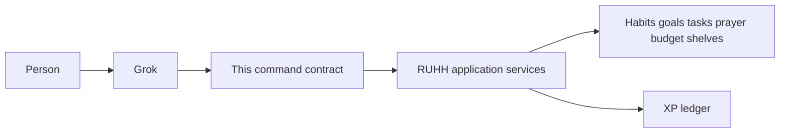

# RUHH Grok integration architecture and command contract (Phase 1)

**Status:** design only. Grok is not connected. Nothing in this file is deployed.
**Date:** 16 November 2026
**Decision 10:** Grok is core, designed now, implemented only after domain services and Gate A are stable. It calls RUHH's authenticated application services. It never writes the database on its own. It never computes XP.

The unmerged branch `origin/feature/security-session-agent` has a `ruhh-agent` function, an inbox, and an in-app approval screen. Its own note says Grok is not connected and writes default off. That branch is a **candidate implementation sketch**, reviewed only as part of Gate A (`RUHH_DATA_BOUNDARIES.md`). This contract does not copy its operation list. In particular it does not include `prayer.set_status` as a write, and it does not let the client send an XP amount.

Where the conversation is drawn (inside the app, or in some later chat) is open. The contract does not depend on that choice.

## 1. Place in the system



Grok's only side effect is a call the app could have made itself. The ledger is reached only by the progression service, which builds `source_ref` and reads the amount from the rules. A command named `xp.grant` does not exist.

## 2. Permission classes

| Class | What Grok may do | Examples |
| --- | --- | --- |
| Read | Run immediately. Return only stored facts. Say when a range is empty. | Today's habits, level, a goal. |
| Propose | Return a plan. Write nothing. | "Learn React in 3 months" becomes a goal draft. |
| Confirm | Apply one proposal the person just accepted, by id. | Create that goal and its milestones. |
| Consequential confirm | Same, but the plan changes history or XP. Show the fact and the `source_ref` before applying. | Complete a milestone. Mark a goal done. |
| Refused | Reject. Do not approximate. | Set XP, score prayer, delete the ledger, bypass confirmation. |

A confirm applies at most the proposal id the person named. A new `request_id` that repeats the same proposal returns the first result. It does not create a second goal.

Destructive confirms (delete a goal, abandon a season, delete a transaction) are consequential. The design prefers the person to confirm in the conversation **and**, when the old agent's approval screen exists after Gate A, to approve deletes there too. Until that screen is actually in the shipping app, a delete is still not silent: Grok only proposes it.

## 3. Envelope

Every call, read or write:

```json
{
  "op": "goals.get",
  "request_id": "8-64 chars, unique per intent",
  "params": {}
}
```

Success:

```json
{
  "ok": true,
  "data": {},
  "meta": { "coverage": "complete", "notes": [] }
}
```

Failure:

```json
{
  "ok": false,
  "error": { "code": "not_found" }
}
```

`meta.coverage` is `complete` or `partial`. Partial means the service could not see a module (for example books not on this device yet). Grok says that. It does not fill the gap with a guess.

`request_id` is the idempotency key for confirms. Reads may still send one so retries are traceable.

Auth is the person's RUHH session, whatever Gate A concludes that session is. Grok does not receive the PIN, the PIN hash, or a service-role key. A dedicated credential, if one is issued later, is scoped to this contract and can be revoked. That issuance is an implementation step, not this phase.

## 4. Reads

All of these execute immediately.

| op | Params | Returns |
| --- | --- | --- |
| `journey.summary` | none | level, title, lifetime XP, XP to next level, active season name or null. No prayer score. |
| `journey.path` | `limit` (1–30) | Recent ledger events and achievement unlocks, newest first, with human reasons. |
| `domains.list` | none | Domains, including archived flag, open-goal counts. |
| `goals.list` | optional `domain_id`, `status` | Goals and milestone fraction or explicit target. |
| `goals.get` | `goal_id` | Goal, milestones, supporting links, linked project ids. |
| `projects.get` | `project_id` | Project and tasks. |
| `planner.today` | optional `date` (local date, default today) | Due habits, quests, tasks, milestones inside 7 days, prayer marked count as a separate object with `xp: false`. |
| `habits.list` | optional `include_archived` | Habits and current streak, best streak. |
| `habits.day` | `habit_id`, `date` | Whether that habit is scheduled and completed. |
| `quests.list` | `window` day, week, or month | Quests and their source ids. |
| `achievements.list` | none | Definitions, unlocked_at or progress count. |
| `seasons.current` | none | Active season and item ids, or null. |
| `books.list` / `movies.list` | optional `status` | Shelf rows. |
| `budget.summary` | `from`, `to` local dates | Existing budget facts, INR. Labeled as money, not as XP. |
| `budget.objectives` | none | Savings and debt objectives. Not life goals. |
| `prayer.today` | optional `date` | Marks for the five prayers. Field `scored: false` always. |

If a date is in the future, the read returns `invalid_date`. Ranges on budget summary stay bounded (the unmerged agent's tests used a maximum span; keep a maximum of 366 days when this is built).

## 5. Proposals

A proposal writes nothing. The response includes `proposal_id`, a short `summary` the person can read, and the exact `params` that a later confirm would apply.

| op | What the plan contains | Confirm class |
| --- | --- | --- |
| `goals.propose` | title, domain, type, milestones[], optional project, optional supporting habits. No XP numbers. | Confirm |
| `habits.propose` | name, schedule, target, domain id optional. Uses the existing habit fields. | Confirm |
| `projects.propose` | title, optional milestone id, tasks[]. | Confirm |
| `quests.propose_custom` | title, window, optional source. | Confirm |
| `milestones.propose_done` | milestone id, the `source_ref` that would be written, amount from the rules (display only). | Consequential |
| `goals.propose_done` | goal id, same disclosure. | Consequential |
| `projects.propose_done` | project id, and whether a milestone rule already pays so the amount is 0. | Consequential |
| `habits.propose_complete` | habit id, date, `source_ref`. Refuses if already completed. | Consequential |
| `tasks.propose_complete` | task id. States that XP is not awarded for the task itself. | Consequential |
| `seasons.propose` | name, length, item ids. | Confirm |
| `seasons.propose_leave` | season id. States that XP is untouched. | Consequential |
| `links.propose` | goal id, kind `book` or `movie` or `budget_objective`, target id. States that the link awards no XP. | Confirm |

`goals.propose` is how "I want to learn React in 3 months" is handled.

Worked plan, not a stored goal:

- Domain: Knowledge & Learning
- Type: medium
- Title: the person's words, lightly cleaned
- Milestones the model suggests: scope what "learn" means, build a small thing, use it on a real task
- Optional habit: three short practice sessions a week
- Optional resource link: none until a book or the shelf has one
- The plan says it will not be created until confirm

Grok does not invent completions in the plan ("you already finished week 1") unless `habits.day` returned them.

## 6. Confirms

| op | Params | Effect |
| --- | --- | --- |
| `proposals.confirm` | `proposal_id` | Applies that proposal through the application service. |
| `proposals.reject` | `proposal_id` | Marks it rejected. Always safe. |

Confirm of a completion calls the same service the screen would call. The ledger then inserts at most one event. A second confirm of the same `source_ref` returns the existing event and `meta.notes: ["already_recorded"]`.

Grok's reply after a successful confirm states what changed and, if XP was written, the reason and the amount the **service** returned. It does not add a second sentence that claims extra points.

## 7. Refused operations

These are not in the catalog. A model that emits them gets `unknown_op` and must tell the person it cannot do that.

- `xp.grant`, `xp.set`, `level.set`
- `prayer.set_status`, `prayer.award`
- Any write whose body includes an `amount` field
- Direct SQL, `ruhh_push`, or a raw table update
- `users` PIN or session minting
- Deleting `xp_events` rows
- Marking a goal complete because a habit was completed

`prayer.today` is the only prayer operation in the initial contract.

## 8. Three conversations

**"I want to learn React in 3 months."**
Read nothing required beyond `domains.list` if the domain id is needed. `goals.propose`. Show the plan. Wait. On yes, `proposals.confirm`. Reply with the created goal id and milestone titles. No XP yet.

**"I finished today's writing."**
`planner.today` or `habits.list`, match the habit by name. If two habits match, ask which. If it is already completed, say so and do not propose. If one matches, `habits.propose_complete`, show the date and the `source_ref`, wait, then confirm. The service writes the habit and, if the rules say so, one ledger row of 8. Grok reports that row. It does not also complete a quest for extra points; the quest follows the habit.

**"How am I doing this month?"**
Reads only: `journey.summary`, `journey.path` bounded to the month, `planner` is the wrong tool for a month, `goals.list`, `habits.list`, `achievements.list`, optionally `budget.summary` if they asked about money. Prayer may be mentioned as marks ("4 days with all five logged") and must not be phrased as a grade. If a module did not load, say it is missing. Do not estimate a life percentage.

**"I prayed fajr."**
`prayer.today` may be read. Grok does not mark the prayer and does not offer XP. It tells the person to mark it in the prayer tracker. This is stricter than a generic "help me log everything", and it is what decision 5 requires.

## 9. Audit

Every confirm stores: `request_id`, `proposal_id`, op name, user id, time, and the service result code. The log does not store the PIN. Reads are counted, not dumped in full, except the op name and the date range. The person can open the recent ledger from My Journey; that is the human-readable half of the same history. Grok does not keep a private copy of XP.

## 10. What is explicitly later

- Issuing credentials, deploying an edge function, choosing Telegram or an in-app thread.
- Rebasing `feature/security-session-agent`.
- Letting low-risk completes run without a confirm. The owner's rule for this design is confirmation for consequential writes. Habit completion writes XP, so it is consequential. A future decision could relax that for a single unambiguous habit. This contract does not.

## 11. Errors the model must surface

| code | Meaning to say aloud |
| --- | --- |
| `not_found` | That record is not in RUHH. |
| `already_recorded` | It was already completed. No second award. |
| `ambiguous` | More than one match. Ask. |
| `needs_confirm` | The plan is ready and nothing was written. |
| `refused` | This command is not allowed. |
| `partial` | Some modules were not available. Do not invent them. |
