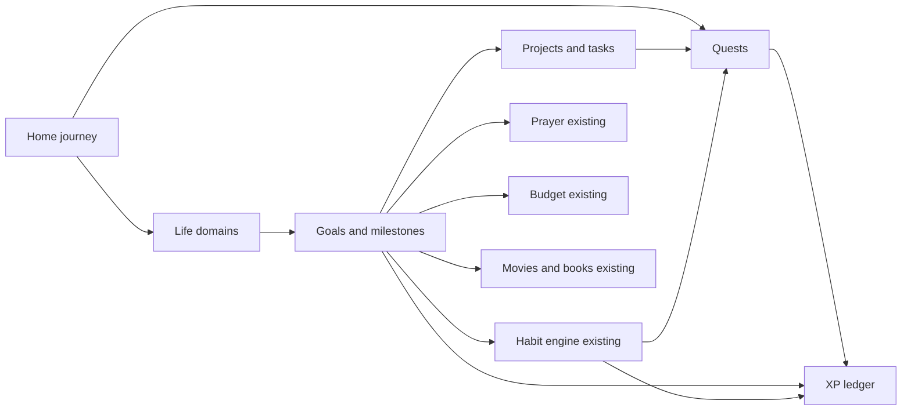

# RUHH implementation roadmap (Phase 0)

**Date:** 16 November 2026
**Status:** audit and proposed Phase 1 only. No application code, migrations, or database changes were made.
**Companion docs:** `RUHH_PRODUCT_VISION.md`, `RUHH_ARCHITECTURE.md`, `RUHH_DATABASE_DESIGN.md`, `RUHH_DESIGN_SYSTEM.md`.

The twelve audit headings from the brief are answered here in short, with pointers to the doc that holds the evidence. Phase 1 is specified in full at the end. Work stops there until the owner approves.

## 1. Current architecture

Flutter app in `ruhh/`, Riverpod, go_router, Isar on device, Supabase RPCs for a snapshot backup. Username and PIN, not Supabase Auth. Six-tab shell. Details: `RUHH_ARCHITECTURE.md`.

The repo is a fork of jameskokoska/Cashew. Commit `77007b00` replaced that app. **No Cashew source file remains.** Budget still uses Cashew-like nouns (wallets, categories, transactions, savings/debt objectives), rewritten in RUHH. Everything else is RUHH-specific.

## 2. Modules and their state

| Module | State on 1.0.34 |
| --- | --- |
| Auth, onboarding, settings | Shipped. Onboarding text omits books. |
| Home | Shipped dashboard titled "Home". Not named My Space. |
| Budget | Shipped (Home, List, Income, Trends, Manage). Objective/account/upcoming pages exist and are not routed. |
| Habit | Shipped and solid (Today, Habits, Stats). Streaks, schedules, quantity, vacations. |
| Prayer | Shipped daily tracker (Today, Calendar, Stats). Older points API has no callers. |
| Movie | Shipped watchlist and watched. Discover/search/library pages are unreferenced. |
| Book | Shipped want-to-read and read. Synced. Missing from onboarding copy and the overlay. |
| Focus, Todos, Island | Code present, no route, nothing imports the pages. |
| Analytics | Route `/analytics` exists. No navigation to it was found. |
| Workout / fitness module | Does not exist. A habit icon is named fitness. |
| Life domains, lifetime goals, milestones, projects, quests, XP, levels, achievements, seasons | Do not exist. |

## 3. Design system

Shipped identity: portfolio desk grid, DM Sans and Outfit, radius 0 on controls and 2 on cards, hairline highlight border, paper shadow plus a hard sticker shadow, module colors for budget/habit/prayer/movie/book, light and dark with **dark as the default**. Root `design-system.md` (soft 24px cards, pills) is not what the app renders. `UI/` neubrutalism package is unused. Full tokens: `RUHH_DESIGN_SYSTEM.md`.

## 4. Database

Twelve cloud tables, all user-owned, RLS on, privileges revoked, no policies, access through PIN-hash RPCs. Isar has those entities plus wallets, categories, periods, salary, habit logs, daily prayer logs, prayer times, todos, and focus sessions. Several client fields are not columns and are lost on pull. Full list: `RUHH_DATABASE_DESIGN.md`. Live production was not inspected.

## 5. Local storage and sync

Isar is the UI source of truth. Cloud is a full-snapshot push then pull, last-write-wins, with guards against an empty local database wiping the server. File CSV backup is wider than the cloud. SharedPreferences holds the session username, theme, notification flags, and the island shop. No secure-storage session on `main`.

## 6. Grok Bot

Not integrated on `main`. The unmerged branch `origin/feature/security-session-agent` contains a `ruhh-agent` Edge Function, an inbox, and an in-app approval screen, and its own doc says Grok is **not connected** and writes default off. That branch is 14 commits past merge-base `2eb2bc78` and is missing the books and movie-category commits that are on `main`. Do not treat it as production.

## 7. What can be reused

Reuse means call the existing type, do not copy it into a new module.

| Keep and build on | Why |
| --- | --- |
| `HabitLocal`, `HabitCompletionLocal`, `HabitLogic`, `habit_calculations.dart` | Already covers frequency, quantity, streaks, best streak, excuses. A life habit is this, plus an optional domain id later. |
| `DailyPrayerLogLocal` and `prayer_calculations.dart` | The real prayer record. Leave the dead points API alone. |
| `TransactionLocal`, wallets, categories, caps, salary engine | The financial module. Do not fold it into "goals". |
| `ObjectiveLocal` | Only as a savings/debt target that a financial life-goal may link to. |
| `BookLocal`, `MovieLocal` | Shelves a learning or leisure goal can point at. Not domains. |
| `HomePage`, `HomeDayHeroSection`, `HomeFeedInsights`, `RuhhTwinMetricRow` | The daily dashboard. Extend the feed; do not replace the page. |
| `RuhhTokens`, `RuhhSoftCard`, `RuhhStatProgressCard`, `RuhhRadialDial`, `RuhhTimelineRow`, `RuhhStepProgress`, `RuhhFloatingNav`, `NBModuleScaffold`, `NBEmptyState` | The visual system. |
| `CelebrationBurst` | One celebration primitive. Level-up can use it later. |
| `notifyLocalDataChanged`, `SupabaseSyncService` snapshot flow | The sync path any new synced entity must join, until a session-based API replaces it. |
| `NotificationService` and the channel list | Add channels later; do not start a second notifier. |
| Habit and prayer tests under `ruhh/test/` | The pattern for pure logic tests. |

## 8. What needs improvement (existing behavior)

Ordered by how much they will hurt a progression system if ignored. None of these are Phase 1 code.

1. **Auth credential is the PIN hash**, returned by `ruhh_fetch_auth_profile` and sent on every sync. New tables on this API inherit that exposure. The unmerged branch is the only design in the repo that addresses it, and it is stale relative to `main`.
2. **Snapshot sync deletes omitted rows** and has no field merge. Progression history cannot live in a table that `ruhh_push` reconciles by omission.
3. **Cloud round-trip drops fields** the client already sends (habit month days and schedule anchor; category-limit month, rollover, category id) and never uploads wallets, categories, periods, or salary.
4. **Two prayer models**, with a lossy mapping onto `prayer_logs`.
5. **Dead UI** that will confuse the next editor: budget objective/account/upcoming/budgets pages, movie discover/home/library/search, `home_redesign_sections.dart`, `AnalyticsPage`, Focus, Todos, Island, prayer points, `prayer_stats_widgets.dart`, `prayer_monthly_grid.dart`.
6. **Onboarding and welcome copy** omit books. The overlay omits books.
7. **Island ledger** recomputes coins from history, but streak bonuses follow the *current* streak and disappear when it resets (`island_ledger.dart`). Spent coins are stored; earned coins are not. It is the wrong seed for XP.
8. **UAT.md is stale** (wrong tab counts). There is no app CI on `main`.
9. **Accessibility:** almost no semantics, no reduced-motion flag, no localization catalogs.
10. **Navigation is full** at six icons. Adding a tab is the wrong move.
11. Unused dependencies: `neubrutalism_ui`, `flutter_animate`, `lottie`, and the shimmer placeholders. Removing them is cleanup, not a feature, and it is out of scope until a phase that is allowed to touch `pubspec.yaml`.

## 9. New capabilities required

These are absent. They are the product in `RUHH_PRODUCT_VISION.md`. They are not approved to build.

| Capability | Needs |
| --- | --- |
| Life domains | A user-owned list, seeded with the eight defaults, editable later. Not `prayer_domain.dart`. |
| Goals | Title, description, domain, type (short / medium / long / recurring / open), priority, dates, status, notes. Separate from `ObjectiveLocal`. |
| Milestones | Belong to a goal. Own completion, optional date, optional progress. Do not auto-complete the goal. |
| Projects and tasks | The how. Optional link to a goal or milestone. Can exist alone. |
| Quest | A dated mission generated from a real habit, task, or milestone, or created by hand. Status, criteria, one completion. |
| XP ledger | Append-only events with a unique reference, reversal rows, and a single level formula. Lifetime total is a sum, not a column clients overwrite. |
| Achievements and seasons | Definitions plus per-user unlocks. A season is a filter over existing items, not a reset. |
| Journey home | Level, title, today's few items, active goals. Built on `HomePage`. |
| Planner | One list for the day drawn from habits, prayer, tasks, and quests. Completion writes the underlying record once. |
| Insights | Counts from real rows. No fabricated series. The unused `AnalyticsPage` is not this. |
| Grok | After the ledger and the write path exist. Reads first. Confirmations for anything consequential. Never a private XP write. |
| Notifications | Milestone due, habit reminder (exists), weekly summary, achievement, goal completed. Opt-in, no guilt copy. |

Prayer completion may later emit an **optional** progression event. It must not be required, and the dead negative point table must not be wired in.

## 10. Recommended order

The brief's phases are right. Two gates are inserted so later phases do not set on a bad foundation. Dates are not estimated.

| Step | What | Code? |
| --- | --- | --- |
| **Phase 0** | This audit. | Docs only. This PR. |
| **Phase 1** | Architecture and UX, specified below. Still no production behavior. | Docs and, only if the owner asks, static wireframe images. No Dart, no SQL. |
| **Gate A** | Owner chooses auth: stay on v1 PIN-hash RPCs, or revive `feature/security-session-agent` onto current `main` (sessions, then retire v1). New cloud tables wait on this. | A later phase, explicitly approved. |
| **Phase 2** | Database foundation: domains, goals, milestones, projects, tasks, quests, XP ledger, achievements, seasons. Additive migrations, rollback, empty-payload behavior decided per table. Repair the known dropped columns in their own migration. | After approval. |
| **Phase 3** | Goals, milestones, projects on top of Phase 2. Link, do not replace, budget objectives and books. | |
| **Phase 4** | Habit engine: domain link, history already present, recovery rules made explicit, tests extended. No rewrite. | |
| **Phase 5** | Quests generated from habits, tasks, and milestones. | |
| **Phase 6** | XP and levels. Only the ledger awards points. Island coins stay out. | |
| **Phase 7** | Home and the visual layer: journey header, today list, using existing tokens. | |
| **Phase 8** | Seasons. They reference existing ids. They delete nothing. | |
| **Phase 9** | Grok. Start from the unmerged agent's read/approve shape, retargeted at current tables plus the new ones. Reads before writes. | |
| **Phase 10** | Insights from the ledger and the existing stats. | |
| **Phase 11** | CI on `main`, backup/restore drill, accessibility, copy, reduced motion. | |

Phases 7's visual work can be sketched in Phase 1, but the widgets land after the models exist so the home does not render fake numbers.

**Do not** start by reskinning the app, by promoting Island, or by putting life goals into `budget_objectives`.

## 11. Risks and migration considerations

| Risk | Why it is real here | Mitigation |
| --- | --- | --- |
| Extending PIN-hash RPCs | `ruhh_fetch_auth_profile` returns the hash (`20260318120000_ruhh_init.sql`). | Gate A before new tables. |
| Snapshot delete eats a ledger | `ruhh_push` removes ids missing from the payload when any entity array is present (`20261112150000_movie_categories_sync.sql`). | XP table is insert-only, not part of reconcile-delete. |
| Overloading budget objectives | Same sync array, money columns, orphaned UI. | New `goals` table. Optional link column to `objective` id. |
| Prayer score becomes moral score | Dead `setStatus` uses −4 for missed. Live tracker has no points. | Do not call it. XP for prayer stays optional and positive-only if it ever exists. |
| Island coins vanish with the streak | Streak bonuses are recomputed from the current streak, not stored as events (`island_ledger.dart`). Spent coins persist. | Leave unrouted. Do not import it into the engine. |
| Cloud restore is partial | Wallets, categories, periods, salary, and the dropped columns. | Document it. Fix columns before a feature depends on them. Do not promise a full restore. |
| Two devices | Last push wins, whole snapshot. | Say so in UX. Do not pretend there is merge. |
| Merging the agent branch blindly | It lacks books and movie categories; `main` lacks its sessions. | Rebase only under Gate A, with the owner. |
| Color type | `int` already overflowed Postgres once. | New color columns are `bigint`. |
| Production data | Not read by this audit. | Any migration is written from the repo, then applied only with the owner's backup and approval. `wipe_all_user_data.sql` is never part of it. |
| Fake data | Forbidden by the brief. | Seeds are domain *definitions* (the eight names), not sample goals or sample XP. |

## 12. Files and components likely affected

Nothing here is edited in Phase 0 or, as proposed, in Phase 1. This is the map for the phase that eventually implements each area.

| Future work | Likely files |
| --- | --- |
| Navigation and home | `ruhh/lib/core/routing/app_router.dart`, `features/home/home_shell.dart`, `features/home/home_page.dart`, `features/home/widgets/home_feed_insights.dart`, `features/home/widgets/home_insight_widgets.dart` |
| New goal / quest UI (later) | New files under `ruhh/lib/features/journey/` or `goals/`. Shared chrome from `core/widgets/ruhh_components.dart`, `nb_scaffold.dart` |
| Habit link to a domain | `core/data/models/habit_local.dart`, `features/habit/habit_form_page.dart`, `habit_repository.dart`, `tracker/habit_calculations.dart` |
| Prayer stays put | `features/prayer/prayer_repository.dart`, `tracker/prayer_domain.dart`, `core/services/supabase_sync_service.dart` (mapping). Do not route XP through `setStatus`. |
| Budget link only | `core/data/models/budget_extras_local.dart` (`ObjectiveLocal`), `features/budget/budget_repository.dart`. The orphan objective pages are not the life-goal UI. |
| Books / movies as links | `book_local.dart`, `movie_local.dart`, their repositories |
| Sync | `supabase_sync_service.dart`, `cloud_sync.dart`, `local_data_sync.dart`, a new migration under `ruhh/supabase/migrations/`, and the current `ruhh_pull` / `ruhh_push` bodies (latest in `20261112150000_movie_categories_sync.sql`) |
| Auth gate | `features/auth/auth_controller.dart`, `core/services/supabase_service.dart`, `core/session/session_providers.dart`, plus the unmerged `cloud_auth_client.dart` if Gate A picks sessions |
| Notifications | `core/services/notification_channels.dart`, `reschedule_all_notifications.dart`, `features/settings/settings_controller.dart` |
| Overlay and widget | `overlay/quick_action_stepper.dart` (no books today), `home_widget_service.dart` |
| Tests to extend, not replace | `ruhh/test/habit_calculations_test.dart`, `prayer_calculations_test.dart`, `budget_calculations_test.dart`, `home_weekly_consistency_test.dart` |
| Leave unused unless a cleanup phase | `UI/`, `features/island/`, `features/focus/`, `features/todo/`, `home_redesign_sections.dart`, `features/home/analytics_page.dart` |

---

## Proposed Phase 1 — product architecture and UX

Phase 1, as defined in the brief, is architecture and UX. It does **not** implement screens in the app, add dependencies, or migrate the database. Approving Phase 1 means approving the following design work. It does not approve Phases 2–11.

### Outcome

A single design pack the owner can mark up:

1. Module boundaries (below, ready for confirmation).
2. Navigation and home structure, drawn with the tokens in `RUHH_DESIGN_SYSTEM.md`.
3. Written workflows for goals, milestones, projects, and quests.
4. Progression rules, including what never awards XP.
5. A list of decisions that are still the owner's.

If the owner wants pictures, they are static frames in the docs, using the real hex values, radius 0/2, DM Sans, and the desk grid. They are not a Flutter prototype and they are not a copy of another app.

### Module boundaries (proposal)

Rules:

- **Home** stays the only top-level "where am I" surface. It is not renamed in code during Phase 1. The design may call the header "My journey" if the owner prefers that to "Home". There is no living-room illustration and no island.
- **Bottom nav stays six icons:** Home, Budget, Habit, Prayer, Movie, Book. Goals, domains, and quests open from Home (pushed routes), not from a seventh tab.
- **Budget** remains money. A Financial Growth goal may link to an `ObjectiveLocal` or to a category cap. The goal's progress is not the wallet balance unless the user says that is the measure.
- **Habits** remain the habit engine. A habit may later carry a domain id. Completing it updates the habit only. A goal that *watches* the habit computes its own progress from a rule, and a single check-in never flips the goal to done.
- **Prayer** remains the tracker. It is not a domain implementation. Spirituality as a life domain can *refer* to prayer consistency. It does not score the person.
- **Movies and books** stay shelves. A learning goal can link a book. The book does not become a goal.
- **Focus and Todos** stay unrouted in Phase 1. The design may reserve "project task" as the future home for a todo, but it does not promise to revive those screens.
- **Island** is out of the product architecture. Coins are not XP.
- **One completion, one write.** The today list does not keep its own copy of a habit check or a prayer mark. It calls the existing repository.

### Navigation and home (proposal)

Home, top to bottom, on the existing desk:

1. **Header.** Greeting (the app already has `homeTimeGreeting`), the person's name, one line for level and title once those exist. Until Phase 6 the line is absent, not a fake "Level 1".
2. **Today.** At most a handful of rows: habits still due, prayers still unmarked, quests due, milestone dates inside a week, project tasks due. Each row uses `RuhhInsightRow` or a sibling with the module color. Overflow is a count, not another stack of cards.
3. **Active goals.** Up to three, each with milestone progress (done / total), not a blended life percentage. Empty state: one sentence and a way to add a goal. No sample goal.
4. **Domains.** Eight names as a quiet list or a 2-column grid of `RuhhSoftCard`, each showing a count of open goals. No rings that pretend to be a percentage of a life.
5. **Recent.** Last achievement or last finished milestone. Hidden when there is nothing.

Budget, habit, prayer, movie, and book screens stay as they are in Phase 1's pictures. Phase 7 is when Home's code changes.

`/analytics` stays unlinked until Phase 10 replaces it with facts from real tables.

### Goal and milestone workflow (proposal)

**Create.** From Home or from a domain. Fields: title, domain, type, why (description), priority, start, optional target date, notes. No XP field on the form. The user can add milestones immediately or later.

**Types.** Short (days to a few weeks), medium (up to about a year), long (multi-year), recurring (a rhythm, not a finish line), open-ended (no date). These are labels and validation, not a different table each.

**Milestone.** Title, optional date, optional numeric target, status: not started, in progress, done, dropped. Dropped is not failure copy. Reordering is manual. A milestone may depend on another milestone of the same goal (one predecessor is enough for the first version).

**Progress.** The goal's displayed progress is milestones done / milestones that are not dropped. If a goal has zero milestones, progress is 0 until the user marks the goal complete themselves. Linked habits show as "supporting", with their own streak, and do not move the milestone fraction.

**Complete.** The user marks the goal complete, or the last not-dropped milestone being done *asks* whether to complete the goal. It does not complete it silently.

**Example the design must be able to hold** (as a worked sketch, not as seed data): "Build a software business" in Career & Business, milestones: validate the idea, build an MVP, first customer, five paying customers, repeatable sales, a steady month of revenue. Projects hang off a milestone. Habits (weekly outreach) hang off the goal and do not check the milestone.

**Budget link.** A milestone "steady month of revenue" may point at a budget objective or at a category. The money module remains the record of the money.

### Projects (proposal)

A project has a title, status, optional goal id, optional milestone id, notes, and tasks. A task has a title, optional date, done flag. Subtasks are one level deep. A project with no goal is allowed (a move, a trip, a repair). Completing every task asks whether to complete the project. Completing a project does not complete a milestone unless the milestone's rule says "when project X is done", and that rule is explicit on the milestone.

### Quest lifecycle (proposal)

States: `proposed`, `active`, `done`, `expired`, `dismissed`.

- A quest is created from something that already exists: today's scheduled habits, a task due today, a milestone due this week, or a custom sentence the user writes.
- Daily generation does not invent chores. If nothing is due, the today list is empty.
- Doing the underlying habit or task marks the quest done. Doing the quest marks the underlying record done. One write, then the quest status follows.
- Dismissed and expired do not remove the habit, the task, or any XP already awarded for a real completion.
- Weekly and monthly quests are the same object with a wider window ("finish 4 of 5 planned workouts"), still computed from real schedules.
- No quest is created for opening the app.

### Progression rules (proposal, for confirmation)

These are the rules Phase 6 would implement. Phase 1 only freezes them on paper.

| Event | XP? | Notes |
| --- | --- | --- |
| App open, page view, sync | Never | |
| Habit completed on a scheduled day | Yes, once per habit per day | Unique key `habit:{id}:{date}`. Quantity habits award once when the target is met, not per increment. |
| Habit missed or excused | No | No negative XP. Streak logic stays in `HabitLogic`. |
| Quest done | Only if it is not already the habit or task event | If the quest is "complete habit H", the habit event is the only award. |
| Milestone done | Yes, once | Key `milestone:{id}:done`. Reversal if the user reopens it. |
| Goal done | Yes, once | Key `goal:{id}:done`. Smaller than the sum of its milestones so the milestone awards stay the main path. |
| Project done | Yes, once, and only if it is not already covered by a milestone rule that names it | Avoid paying twice. |
| Prayer marked prayed | Optional, default off | If the user turns it on: one small award per day when the day is complete, key `prayer:{date}`. Never per-prayer, never negative, never shown as a judgment. |
| Budget transaction saved | No | Spending is not virtue. A milestone the user defined ("save X") awards when *that milestone* is marked, not when a transaction posts. |
| Movie or book logged | No | A milestone can name a book. Logging the book does not award XP by itself. |
| Streak threshold 7 / 30 / 100 / 365 | Achievement, once ever | Not the island coin table. Lifetime best is kept when the current streak breaks. |
| Island coins | Never imported | |

Level is one function of lifetime XP (sum of non-reversed events), stored in one place. The curve is configurable constants in one module, not literals in widgets. The UI can show the last few events in plain language ("+ milestone · first customer").

Spendable currency is **out of scope**. If it ever exists, it is not lifetime XP.

### Seasons (proposal, sketch only)

A season has a name, a length (30, 60, 90, or custom), a status (active, paused, completed, abandoned), and a set of goal and habit ids. Abandoning it hides it from Home and deletes nothing else. No season is required to use the app.

### Copy and accessibility (constraints on the pictures)

- Empty states tell the user what they can do. They do not comment on character.
- Dates show the device timezone. The design notes that habits are date-keyed (`dateKey`), which is already a local calendar date.
- Every new control in the wireframes gets a visible label or an explicit screen-reader label.
- Celebration is a single burst. The layout still reads if it is removed.
- Light and dark frames both, dark first.

### Phase 1 deliverables

| # | Deliverable | Where it would go |
| --- | --- | --- |
| 1 | Confirmed boundary diagram and the "do not reuse this table" list | Update `RUHH_ARCHITECTURE.md` or add `docs/RUHH_UX_ARCHITECTURE.md` |
| 2 | Home wireframe, dark and light, annotated with token names | Same doc |
| 3 | Goal create, milestone list, and today-list flows, step by step | Same doc |
| 4 | Quest state machine and the "no double XP" table | Same doc |
| 5 | Owner decision log filled in | Bottom of that doc |

No Dart files. No SQL files. No edits to `pubspec.yaml`. No Supabase commands.

### Phase 1 non-goals

- Implementing goals, XP, or a new home in Flutter.
- Merging `feature/security-session-agent`.
- Fixing sync drift (that is Phase 2, after Gate A).
- Deleting dead screens (a cleanup can ride along with the phase that touches those files, not before).
- Connecting Grok.
- Changing prayer theology, budget math, or habit streak math.

### Decisions needed from the owner before Phase 1 is "approved"

1. **Visual identity.** Confirm the shipped desk (radius 0/2, grid, DM Sans, dark default) and reject root `design-system.md` as the target. If the owner actually wants the soft spec, Phase 1 changes and the component audit has to be redone.
2. **The word on the header.** Keep "Home", or use "My journey"? "My Space" and "living room" are not in the app. Say which phrase should appear.
3. **Nav.** Confirm the six icons stay, and goals live under Home.
4. **Domains.** Confirm the eight default names, and that they are user-editable later rather than fixed forever.
5. **Prayer.** Confirm: no XP by default, never a negative score, and the old points code stays unused.
6. **Island, Focus, Todos.** Confirm they stay unrouted and out of the engine.
7. **Movies and books.** Confirm they stay shelves, outside domain percentages.
8. **Budget objectives.** Confirm they stay money goals, linkable, not renamed into life goals.
9. **Gate A.** Before any cloud table: stay on PIN-hash RPCs, or schedule a rebase of the session/agent branch onto current `main`? Recommendation: do not add progression tables on v1 auth. This audit did not verify production, so the owner also needs to say whether that branch was ever applied to ref `gmmfimwumtbneynsyimz`. The branch doc says it was not.
10. **Grok timing.** Confirm Grok waits until Phase 9, and that the existing unmerged agent is the starting point rather than a new bot with its own database writes.
11. **Currency of the product.** Budget is INR-shaped (`budget_inr.dart`). Life modules should stay currency-free. Confirm.
12. **Phase 1 output.** Confirm docs and static frames are enough, with no Flutter prototype in the app.

Until those are answered, Phase 2 should not start. If a decision above is changed later, the change gets written into the UX doc before code follows it.

---

## Phase 0 verification

The environment did not have Flutter on `PATH`. The stable SDK **3.44.8** (Dart **3.12.2**, framework revision `058e0af2c2`) was downloaded for this audit. That is the version pinned in `.github/workflows/ruhh-ci.yml` on `origin/feature/security-session-agent`. That workflow is not on `main`, and `main` has no app CI of its own. A placeholder `.env` was copied from `ruhh/.env.example` so the asset bundle could load. It was not committed. `flutter pub get` did not change `ruhh/pubspec.lock`.

| Command | Working directory | Result |
| --- | --- | --- |
| `flutter --version` | — | Flutter 3.44.8, Dart 3.12.2 |
| `flutter pub get` | `ruhh/` | Exit 0. "Got dependencies." 90 packages have newer versions outside the current constraints. |
| `flutter analyze --no-fatal-infos --no-fatal-warnings` | `ruhh/` | Exit 0. **147 issues, 0 errors, 69 warnings, 78 infos.** Exit 0 is because warnings and infos were set non-fatal, matching the unmerged CI script. A default `flutter analyze` would fail on these warnings. |
| `flutter test` | `ruhh/` | Exit 0. **17 passed, 1 skipped.** |

The skipped test is `ruhh push empty payload does not require delete` in `ruhh/test/supabase_rpc_smoke_test.dart` (`skip: !_hasSupabaseEnv()`). `SUPABASE_URL` and `SUPABASE_ANON_KEY` were not set, on purpose, so this run did not call production.

Largest lint groups: `unnecessary_underscores` (53), `experimental_member_use` (36), `unused_import` (17), `library_private_types_in_public_api` (8), `unused_local_variable` (7). These were not fixed. Phase 0 does not change Dart.

Tests that passed cover budget calculations (including a negative balance when spending exceeds income), notification payload routing, streak-protection scheduling, budget threshold alerts, prayer streak and timing, one habit streak example, and movie sort order. They do not cover sync conflict behavior, RLS, auth, or the unrouted modules.

No production Supabase command was run. No migration was applied.
