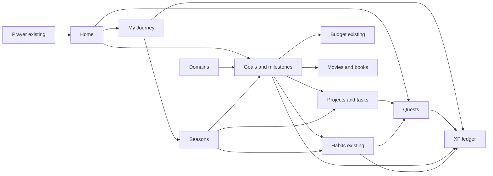
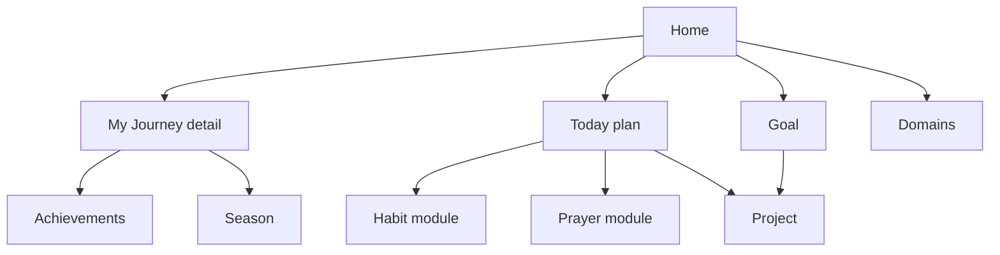
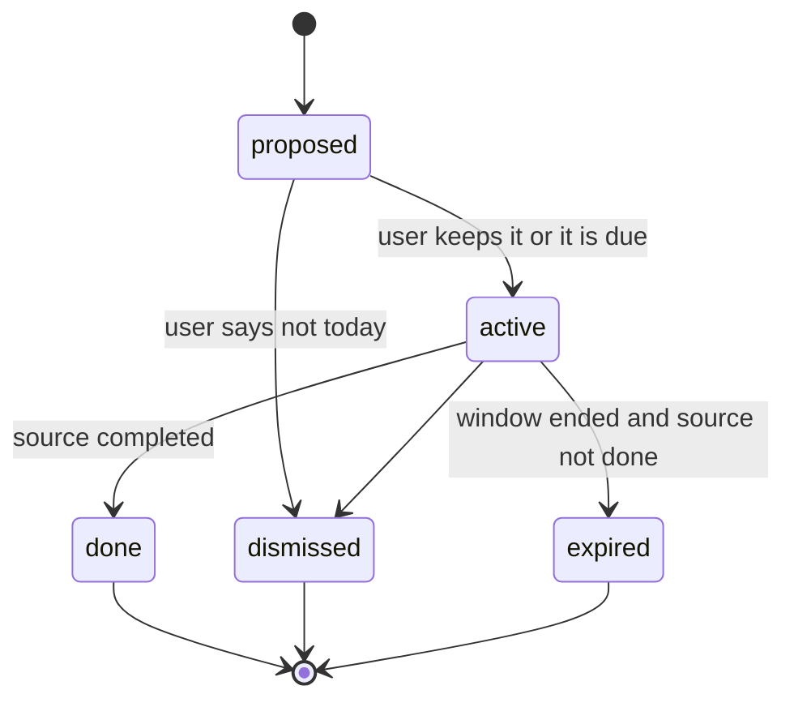
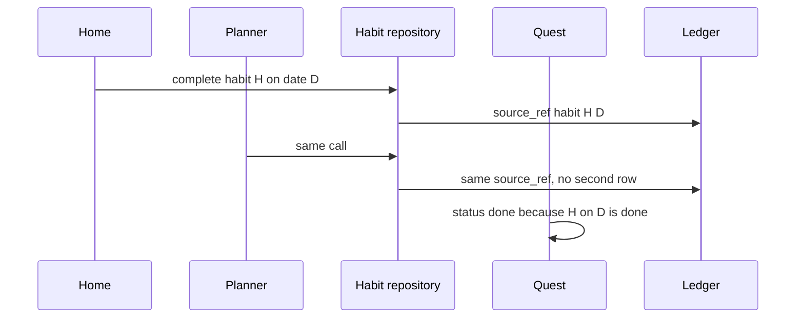

# RUHH product and module architecture (Phase 1)

**Status:** approved direction, designed. Not implemented.
**Date:** 16 November 2026
**Decisions:** `RUHH_OWNER_DECISIONS.md`
**Frames:** `docs/designs/README.md` and `docs/designs/png/`
**Data rules:** `RUHH_DATA_BOUNDARIES.md`
**Grok:** `RUHH_GROK_INTEGRATION.md`

Sample numbers in the frames are one illustrative life, not a user and not seed data. The level math below is what those numbers use.

## 1. Shape of the product

RUHH stays a personal desk. Home answers the day. My Journey answers the lifetime. The six modules that already ship keep their jobs.

The dashed line is deliberate. Prayer is visible on Home and in the planner. It does not enter the ledger.

## 2. What each module is

| Module | Role in the life system | Untouched job |
| --- | --- | --- |
| Home | Desk for today, with My Journey as the first card. | Title stays Home. |
| My Journey | Level, title, lifetime XP, path, achievements, season entry. Pushed from the card. Not a tab. | None today. This is new. |
| Domains | Eight defaults, editable. A place goals belong. | Not `prayer_domain.dart`. |
| Goals and milestones | What the person is aiming at, and the steps. | Not `ObjectiveLocal`. |
| Projects and tasks | How a milestone, or a standalone effort, gets done. | Todos stay unrouted. A later evaluation may map them here. Not now. |
| Habits | The existing engine. Optional supporting link from a goal. | `HabitLocal`, streaks, schedules. |
| Quests | A dated view of something that already exists, or a custom quest the user writes. | Not a second task list. |
| Prayer | The daily tracker. | No XP, no toggle, no points code. |
| Budget | Money, INR, existing math. | Objectives stay objectives. |
| Movies, books | Libraries. Optional resource links. | No domain score, no XP. |
| XP ledger | The only place points are born. | Not Island. |
| Seasons | An optional focus set. | Cannot reset the ledger. |
| Island, Focus | Out of the surface. Code stays. | Coins are not XP. Focus is a later utility question. |

## 3. Navigation

Bottom bar, unchanged, icon only, square:

Home · Budget · Habit · Prayer · Movie · Book

No seventh tab. Analytics stays unlinked until a later insights phase. Dead screens (island, focus, todos, unused movie pages, budget objective pages) are not given routes in this design.

## 4. Home and My Journey

Home's title is Home. The header also has **Ask**, which opens the in-app Grok surface. It is not a seventh tab. The first card is My Journey: a level seal, the title, a short trail of levels walked, lifetime XP, the bar to the next level, and the active season if one exists. Under it, one quiet line when the person has been away. The sample says "Three quiet days. Nothing was taken back." That is the tone. It is not a scolding.

Today's rows are stamped Habit, Quest, or Prayer so they are not one list. Goals are stamped Goal and, when they have milestones, show the path as small squares. Under the goals, **New goal** and **Domains** are always visible. Domains are not only reachable by knowing a gesture.

Then Today: habits still due, quests that point at real work, prayer as a count with the words "not part of XP". Then up to three active goals, each with a milestone fraction or an explicit target such as "3 of 12 books". Then the person can open domains from this area in the implementation; the frame keeps the goals visible and puts domain management on its own screen so Home does not become a grid of eight charts.

My Journey detail is the path: the same level, then events in time, including a gap that does not subtract XP. Buttons go to achievements and the season. The lifetime line says it has never been reset.

Frames: `home-dark.png`, `home-light.png`, `journey-dark.png`, `journey-light.png`.

## 5. Domains

Defaults, in this order, with accents taken from colours the app already has (`nb_colors.dart` and `RuhhTokens`):

| Domain | Accent |
| --- | --- |
| Health & Fitness | `#4ADE80` habit |
| Spirituality | `#A78BFA` prayer |
| Knowledge & Learning | `#FBBF24` book |
| Discipline | `#94A3B8` slate |
| Career & Business | `#38BDF8` sky |
| Financial Growth | `#FB923C` peach |
| Relationships | `#FB7185` movie / coral |
| Personal Development | ink, the theme's primary text colour |

The person can add, rename, reorder, and archive. Archive sets `archived_at`. Goals already filed there remain in history and leave Home. A new goal cannot be filed in an archived domain until it is restored.

A domain shows a count of open goals. It does not show a percentage of a life. Spirituality can hold goals the person writes. It does not display a prayer score.

Frame: `domains-dark.png`, `domains-light.png`.

## 6. Goals, milestones, projects

### Create a goal

From Home or from a domain. Fields: title, domain, type, description, priority, start date, optional target date, notes. Types: short, medium, long, recurring, open-ended. No XP field on the form. The amount, if the goal is later completed, comes from the rules table.

### Milestones

Each milestone has a title, order, status (`not started`, `in progress`, `done`, `dropped`), an optional date, an optional numeric target, and an optional predecessor in the same goal.

**Displayed progress** is milestones done divided by milestones that are not dropped. Zero milestones means the bar stays empty until the person marks the goal done themselves. A linked habit never moves the fraction.

When the last not-dropped milestone is done, the UI **asks** whether to complete the goal. It does not complete it alone.

Dropped is a quiet status. It is not failure copy.

### The worked example

"Build a software business", Career & Business, long. Milestones, in order:

1. Validate the idea — done.
2. Build an MVP — in progress, project "Build the MVP" linked.
3. First customer — waiting on the MVP.
4. Five paying customers.
5. Repeatable sales.
6. A steady month of revenue — points at budget objective "Monthly revenue". The objective stays in Budget. INR stays there.

Supporting habit "Weekly outreach" is named on the goal and cannot complete it.

Frame: `goal-dark.png`, `goal-light.png`. The sample is 1 of 6, matching one done milestone.

### Projects

A project has a title, status, notes, optional goal, optional milestone, and tasks. One level of subtasks. A project with no goal is allowed.

Completing every task **asks** whether the project is done. Completing the project does not complete the milestone unless that milestone's rule says "when this project is done", and that sentence is stored on the milestone. XP follows the double-pay rules below.

Frame: `project-dark.png`, `project-light.png`.

### Measurable values

Any goal or milestone may carry `current_value` and `target_value`. They are plain numbers. They are not a currency. A Financial Growth goal may show a number and a link to an INR budget objective. The rupees stay on the objective.

"Read books" in the sample is a **recurring** yearly goal, not a single bar that forgets last year.

- The goal stays open across years.
- Each year is a `goal_period` with its own `current_value`, `target_value`, and status.
- The goal's own `current_value` and `target_value` mirror the **open** period, so Home can show "2026 · 3 of 12" without pretending that is the whole history.
- 2025 can be completed at 9 of 12 and stay on the record. 2024 can be missed at 4 of 12. Missing a period removes no XP.
- Logging a book on the shelf does not increment the period. The person records the count.
- Completing a period does not complete the goal and does not pay the goal award of 60. That award is only when the person ends the goal itself, after the confirmation sheet.
- A non-recurring measurable goal (a one-time "save toward 50,000", with the money still in Budget) uses `current_value` and `target_value` on the goal and has no periods.

Frame: `measure-dark.png`, `measure-light.png`.

A milestone may also have a target, such as "five paying customers" with `target_value` 5. That does not turn the milestone into a goal.

## 7. Habits

The habit engine is not rewritten. A goal may link habit ids. The link is "supporting".

Checking the habit anywhere writes `HabitCompletionLocal` for that habit and local date, exactly as today. Streaks stay in `HabitLogic`. A missed day breaks or pauses a streak the way the current code already does. It does not write negative XP and it does not delete past awards or achievements.

Vacations and excused days stay excused. They are not punishments.

## 8. Quests

A generated quest is not a permanent object hanging off a habit. Its identity is one source and one time window:

`quest_key = {source_kind}:{source_id}:{window}:{window_key}`

| Source | Window | Key |
| --- | --- | --- |
| Habit scheduled on Monday 16 November 2026 | day | `habit:{habitId}:day:2026-11-16` |
| Task due that day | day | `task:{taskId}:day:2026-11-16` |
| Milestone inside the next seven days | week | `milestone:{id}:week:2026-W47` |
| Custom quest the person writes for today | day | `custom:{questId}:day:2026-11-16` |

`quest_key` is unique per user. Generating today's plan upserts those keys. It does not insert a second row. Tomorrow's habit is a different key. There is no single quest that lives for the life of the habit.

Generation, once a day when the app opens or the planner opens:

- Each habit scheduled today and not yet completed becomes, or refreshes, one active quest whose source is that habit. If the habit is completed, the quest is done. No second quest is created.
- Each task due today and not done becomes one quest whose source is that task.
- A milestone with a date inside the next seven days and status in progress may appear on the week strip. It is the milestone, not a new chore.
- If nothing is due, the plan says so and stops. "Nothing else is due. An empty afternoon is allowed."
- The user may write a custom quest. That is `proposed` until they confirm it. A custom quest with no source can award the small quest amount once, because nothing else will pay.

Dismiss and expire do not delete the habit, the task, the book, or any XP already stored.

### When the source is undone

The quest follows the source. It does not keep its own private "done".

- Habit completion removed, and the window is still open: the quest returns to active.
- Habit completion removed, and the window has ended: the quest becomes expired. It is not left done.
- Completing the habit again uses the same `quest_key` and marks that quest done again. No second quest.
- The XP side of the same undo is a reversal, then a new generation if they complete it again. See `RUHH_DATA_BOUNDARIES.md`. The quest award is not a second payment when the quest's source is the habit or the task.

Frame for the undo sheet: `undo-dark.png`, `undo-light.png`.

Weekly and monthly quests use the same object and a wider window, still counted from real schedules ("4 of the 5 days this habit was planned"). They are not a stack of extra tasks.

Frame: `planner-dark.png`, `planner-light.png`.

## 9. One write

Grok uses the same call. It does not write a parallel flag.

## 10. XP and levels

### Rules

| Fact | Award | source_ref | Notes |
| --- | --- | --- | --- |
| Habit completed on a scheduled day | 8 | `habit:{id}:{date}` | Once when the target is met. Not per increment. Not if excused or missed. |
| Custom quest done, and it is not a proxy for a habit or task | 6 | `quest:{id}:done` | Proxy quests pay nothing extra. |
| Milestone done | 40 | `milestone:{id}:done` | Reopen inserts a reversal. |
| Goal done, user confirmed | 60 | `goal:{id}:done` | Not the sum of its milestones. |
| Project done, and no milestone rule already names it as the payment | 24 | `project:{id}:done` | Otherwise zero. |
| Achievement unlocked | the achievement's own amount, often 0 | `achievement:{id}` | Once ever. |
| Prayer marked | 0 | none | Outside the engine. No toggle. |
| Transaction saved, book logged, movie logged, app opened | 0 | none | |
| Missed day | 0 | none | Never negative. |

These integers are the starting table. They live in one rules record, not in widgets. Change the integers before build if you want a different pace. Do not change the "once / never negative / prayer excluded / no double pay" rules without a new decision.

### Level curve

Level 1 is 0 XP. For level L greater than 1:

`threshold(L) = floor(50 * (L - 1) ^ 1.55)`

The person is at the greatest L whose threshold is less than or equal to lifetime XP. Lifetime XP is the sum of amounts on events that have not been reversed.

| Level | XP required | Span of this level |
| --- | --- | --- |
| 1 | 0 | 50 |
| 2 | 50 | 96 |
| 7 | 803 | 217 |
| 8 | 1,020 | 235 |
| 9 | 1,255 | 251 |
| 20 | 4,797 | 397 |
| 35 | 11,823 | |
| 50 | 20,834 | |

The curve is long on purpose. Level 50 is tens of thousands of XP, which is years of ordinary awards, not a weekend.

### Sample used in the frames

- **12 Nov, the moment:** lifetime was 990 (level 7, 30 XP short of 1,020). Milestone "Validate the idea" pays +40. New total 1,030. Level becomes 8. Frame: `levelup-*.png`. The dimmed desk behind still shows level 7, which is the state before Continue.
- **16 Nov, the resting desk:** lifetime 1,094 (the crossing, plus later habit awards of 8). Level 8. 161 XP to level 9. Bar about 31% of the level-8 span. Home, journey, and season use this.

### Titles

Quiet labels, not ranks of worth. They change with level and can be edited later without a schema change if they stay a function of level.

| Levels | Title |
| --- | --- |
| 1–3 | Beginning |
| 4–6 | Showing up |
| 7–11 | Finding your rhythm |
| 12–19 | In motion |
| 20–34 | The long view |
| 35 and above | Still here |

The sample is level 8, so the title is "Finding your rhythm" on both sides of the level-up. The owner set that band on 16 November 2026. The other titles stay provisional. The number changes. The title does not have to, and in this case it does not. That is intentional: a level is not a new personality.

The provisional amounts are unchanged. What they do over 30 days, 90 days, a year, and two years is in `RUHH_XP_BALANCE.md`.

### Showing the award

The moment is a square card over a dimmed desk. It names the fact ("Milestone completed · Validate the idea"), the amount, the new total, and the words "Recorded once". Square specks in mint, amber, sky, and lavender are the motion. It lasts under half a second. If the person has asked for less motion, the card still appears and the specks do not. The layout makes sense with the specks removed.

There is no coin, no character, and no full-screen takeover that hides the desk entirely. The Home title remains visible behind the sheet.

## 11. Achievements

Categories from the vision: First Steps, Consistency, Discipline, Fitness, Learning, Spiritual Growth, Financial Progress, Goal Completion, Long-Term Dedication, Rare.

Automatic examples in the frame:

- First week kept. Any one habit completed on seven scheduled days. Stays unlocked if the streak later dies.
- Idea on paper. First milestone completed on a long goal.
- A year of showing up. Progress is "days that have at least one real completion", shown as a count, not as a scolding percentage. 18 recorded days does not imply the other days were failures.

Spiritual Growth has **no** automatic rule. The frame says the person may write their own, and RUHH will not invent one from prayer. Fitness achievements, when they exist later, key off habits the person filed under Health & Fitness, not off a workout module that does not exist.

Unlocks are rows in `user_achievements`. They are not recomputed away.

Frame: `achievements-dark.png`, `achievements-light.png`.

## 12. Seasons

Optional. Length 30, 60, 90, or a custom end date. Status: active, paused, completed, abandoned.

A season holds references to goals, habits, and projects. It does not copy them. Prayer is not pulled in unless the person adds a goal that they themselves consider spiritual. Movies and books are not members by default. Adding a book still awards no XP.

Pause, extend, and leave are explicit. Leave asks for confirmation, because it ends the focus. It does not touch the ledger, the level, achievements, or habit history.

The sample is "Ninety days on the business", day 18 of 90, containing the business goal, the outreach habit, and the MVP project. Copy on the card: level and lifetime XP stay either way.

Frame: `season-dark.png`, `season-light.png`.

## 13. Breaks

A gap in the path is a labeled pause. The sample gap is "28–30 Oct · away. Streak paused. Lifetime XP unchanged." No quest is generated to "make up" those days. No XP is removed. The next scheduled habit is simply due again when the person returns.

## 14. Copy

- Empty means "nothing is due", not "you failed".
- Prayer is never described as a score.
- Domain lines are counts.
- Buttons are verbs: Continue, Pause, Extend, Leave, Add a domain.
- The screen title Home is never replaced with My Journey.

## 15. Motion and accessibility, for a later build

Timings, the level sequence, and reduced motion are in `docs/designs/MOTION.md`. Short version: fills and the level seal move in under half a second, specks are optional, and reduced motion keeps every state change and drops the travel.

- Entrance of the Home list can keep the existing stagger.
- Every icon-only control in these frames gets a name in implementation (the nav already has paths; the back control is "Back", Ask is "Ask").
- Dates are local calendar dates, consistent with habit `dateKey`. The sample "today" is Monday 16 November 2026.
- Both themes are drawn. Dark is the default, matching `SettingsController`.

Stamps (Habit, Quest, Project, Goal, Prayer) are words plus a colour, so the difference survives without relying on hue alone. Goals, quests, and projects are different objects. The stamps are how the desk says so.

## 16. Out of this design

Flutter widgets, routes, SQL, Island, the old prayer points, a life percentage, a seventh tab, and any Grok write that skips confirmation. The command list is the next document.
