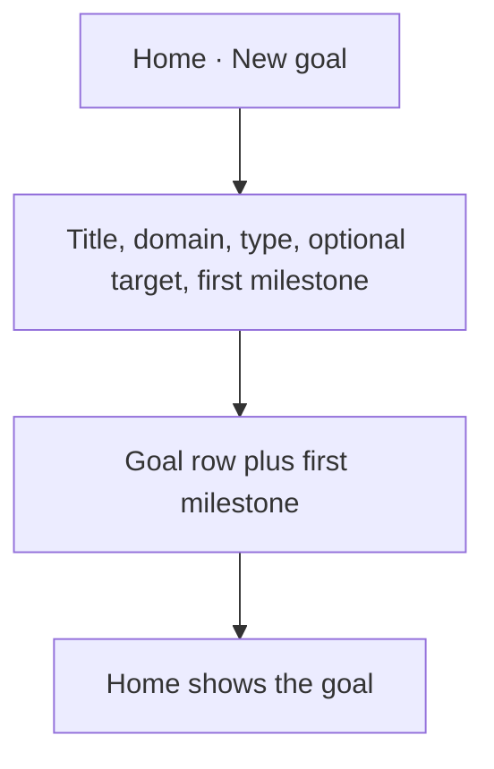
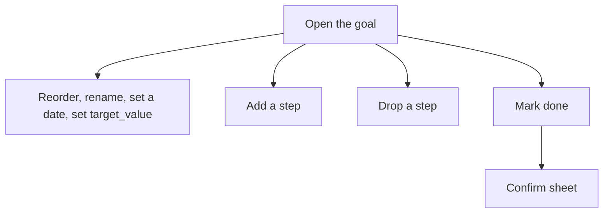
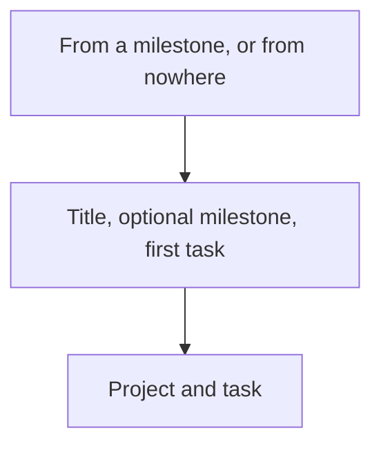
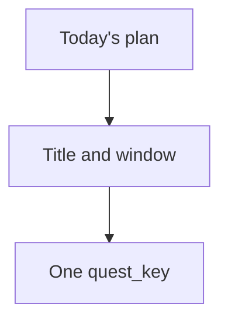
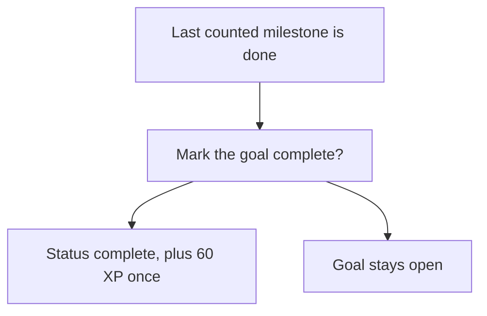
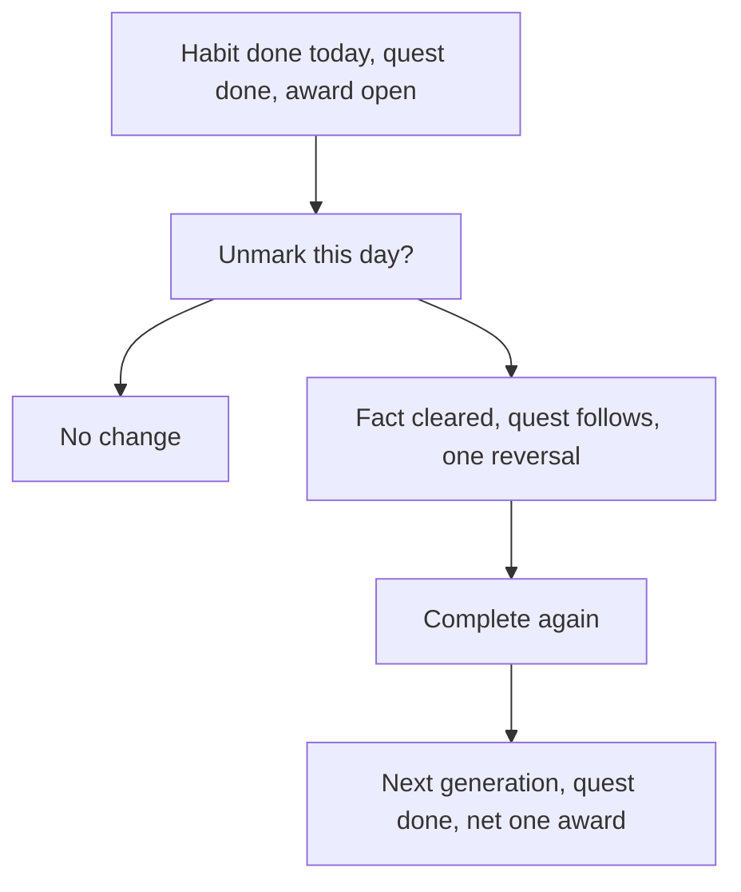

# RUHH user journeys (Phase 1)

**Status:** design only.
**Date:** 16 November 2026
**Frames:** `docs/designs/png/`. The desk screens show a life in progress. These flows are how that life gets written.

The person is always confirming with a button they can see. Grok uses the same services and, for anything it proposes, an extra confirm. Filling a form in the app and pressing Create is the confirmation for that form. It does not ask twice.

No flow awards XP by opening a screen. XP is a consequence of a completed fact, through the ledger rules in `RUHH_DATA_BOUNDARIES.md`.

## 1. Create a goal

Frame: `create-goal-dark.png`, `create-goal-light.png`.

Fields: title, domain, type (short, medium, long, recurring, open), optional `target_value` when it is measurable, optional cadence when it is recurring, optional first milestone. No XP field.

Save writes the goal and, if they typed one, the first milestone at status not started. `current_value` starts at 0 when a target exists. A recurring goal also opens period one.

Cancel writes nothing.

Undo, from the goal, within the session: delete is the wrong word for history that later gains milestones. A goal with no completions and no ledger rows may be discarded. Once any milestone is done, discard becomes archive. Archive hides it and keeps the ledger.

## 2. Add and edit milestones

Frame: `milestones-dark.png`, `milestones-light.png`. The path they sit on is `goal-*.png`.

- Reorder changes `sort` and, if they set one, the predecessor. No XP.
- Rename and dates do not award XP.
- A step may have its own `current_value` and `target_value` (the sample step "Five paying customers" uses 5).
- Dropped steps leave the fraction (done / not-dropped) and stay in the history.
- Mark done opens a confirm that names +40 XP once. Not yet leaves the step in progress.
- The last counted step, when done, does not complete the goal. That is flow 5.

## 3. Create a project

Frame: `create-project-dark.png`, `create-project-light.png`. The project itself is `project-*.png`.

The project is how. The milestone is what. Linking is optional. Creating a project does not move the milestone and does not pay XP.

Later, marking every task done asks whether the project is done. Marking the project done does not mark the milestone done unless that milestone says this project completes it. If the milestone will pay, the project pays 0.

## 4. Create a custom quest

Frame: `create-quest-dark.png`, `create-quest-light.png`. Today's generated plan is `planner-*.png`.

A custom quest has no habit and no task. Its key is `custom:{id}:day:2026-11-16` (or week, or month). It is not regenerated tomorrow.

Because nothing else will pay, completing it can award 6 XP once. The plan says so before they add it.

A generated quest is not created on this screen. The planner builds those from sources. See the quest identity rules in `RUHH_UX_ARCHITECTURE.md`.

## 5. Complete a goal

Frame: `goal-done-dark.png`, `goal-done-light.png`.

The sheet says the 60 is not the sum of the milestones. Not yet leaves every milestone as it is. The person can also open this sheet from the goal when they decide it is finished even if a step was dropped.

Completing a recurring **period** is not this flow. The period row closes. The goal stays. There is no 60. Frame: `measure-*.png`.

## 6. Undo and recovery

Frame: `undo-dark.png`, `undo-light.png`.

What the sheet promises, and what the services do:

| Undo | Source | Quest | Ledger |
| --- | --- | --- | --- |
| Unmark a habit for a date | Completion for that date cleared | Same `quest_key` returns to active if the window is open, otherwise expired | One reversal of the open award. A later complete writes the next generation. |
| Unmark a task | `done_at` cleared | Its quest follows the task | No XP unless a project or milestone award was already paid for a larger fact. That larger award is not reversed by unmarking one task. |
| Reopen a milestone | Status returns to in progress | Week quest follows | One reversal of that milestone award. The goal, if already completed, stays completed until the goal itself is reopened. The sheet says so when that is the case. |
| Reopen a goal | Status returns to active | None | One reversal of `goal:{id}:done`. Milestones stay done. |
| Discard an empty new goal | Goal removed | None | No ledger row existed. |

A second undo of the same award does nothing new. The reversal is already there.

Recovery after a break is not an undo. The journey already shows a gap. Nothing is clawed back. The next scheduled habit is simply due.

## Where Grok fits

Grok does not get a private version of these flows. Ask on Home opens `grok-*.png`. A sentence becomes a proposal. Confirm runs the same create or complete service as the button on the form. Not now writes nothing. Prayer is not in this list.
