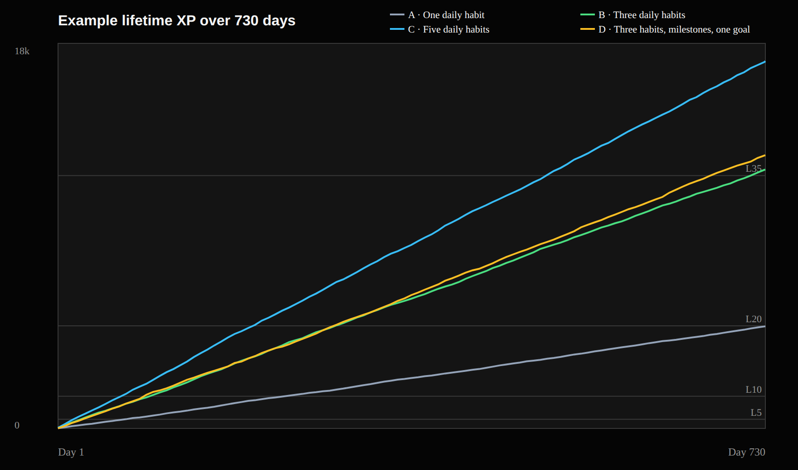

# Provisional XP balance

**Status:** the amounts stay as specified. This page is the check to read before anyone builds them.
**Amounts:** habit 8, custom quest 6, milestone 40, goal 60, project 24.
**Curve:** `floor(50 × (level − 1) ^ 1.55)`, level 1 at 0 XP.
**Script:** `docs/tools/xp_level_sim.py`. It is not app code. It does not write a ledger.

## Assumptions

- Habits are scheduled every calendar day. A real week with days off would be lower.
- Each habit is completed independently at the rate below.
- **Expected** columns are `days × habits × rate × 8`, plus the fixed extras in profile D. They are not a lucky streak.
- **Example** columns are one seeded path (`random` seed 16 plus the profile letter). The chart is those paths, one point a week.
- Proxy quests pay nothing. Prayer, books, movies, and transactions pay nothing.
- Profile D's project award is 0, because its milestones already pay.
- A recurring period pays nothing in this table. The goal award of 60 is once, on day 400 in profile D.
- Profile D also completes a milestone on days 90, 180, 270, 360, 450, 540, 630, and 720 (40 each) and one custom quest every 30 days (6).

| Profile | What it is | Rate |
| --- | --- | --- |
| A | One daily habit | 80% |
| B | Three daily habits | 70% each |
| C | Five daily habits | 60% each |
| D | Three daily habits, plus milestones, one goal, a few custom quests | 70% on the habits |

## Results

| Profile | Window | Expected XP | Level | Title | Example XP | Example level |
| --- | ---: | ---: | ---: | --- | ---: | ---: |
| A | 30 days | 192 | 3 | Beginning | 184 | 3 |
| A | 90 days | 576 | 5 | Showing up | 552 | 5 |
| A | 1 year | 2,336 | 12 | In motion | 2,352 | 12 |
| A | 2 years | 4,672 | 19 | In motion | 4,776 | 19 |
| B | 30 days | 504 | 5 | Showing up | 520 | 5 |
| B | 90 days | 1,512 | 10 | Finding your rhythm | 1,432 | 9 |
| B | 1 year | 6,132 | 23 | The long view | 6,064 | 23 |
| B | 2 years | 12,264 | 35 | Still here | 12,096 | 35 |
| C | 30 days | 720 | 6 | Showing up | 696 | 6 |
| C | 90 days | 2,160 | 12 | In motion | 2,072 | 12 |
| C | 1 year | 8,760 | 29 | The long view | 8,576 | 28 |
| C | 2 years | 17,520 | 44 | Still here | 17,168 | 44 |
| D | 30 days | 510 | 5 | Showing up | 502 | 5 |
| D | 90 days | 1,570 | 10 | Finding your rhythm | 1,522 | 10 |
| D | 1 year | 6,364 | 23 | The long view | 6,232 | 23 |
| D | 2 years | 12,788 | 36 | Still here | 12,772 | 36 |

Level 20 begins at 4,797 XP. Level 35 begins at 11,823. Level 50 begins at 20,834. None of these profiles reach level 50 in two years.

## What this suggests, without changing the amounts

A single daily habit, kept most days for two years, is still in **In motion**, just short of **The long view**. That matches a long life record.

Three daily habits at 70% reach **Still here** (level 35 and above) inside two years. Five habits get further into that same band, not to level 50. Milestones and one finished goal (profile D versus B) add a few hundred XP across two years. They do not define the level. The daily awards do.

If **Still here** should take longer than two years of three habits, the curve's exponent is the lever. Raising the habit amount would make the top band arrive sooner, which these numbers do not argue for.

The sample desk (level 8, 1,094 XP) is a person early in **Finding your rhythm**, which is where profile B sits somewhere before 90 days. It is not the two-year picture.
