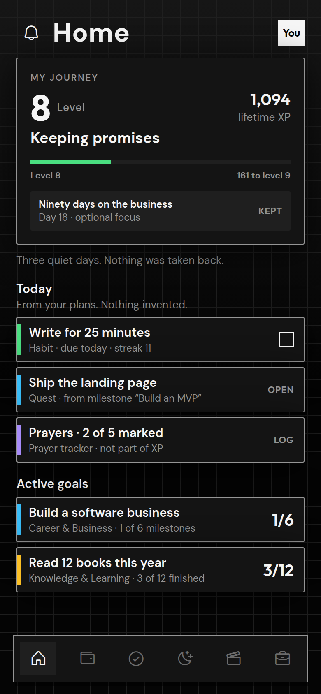
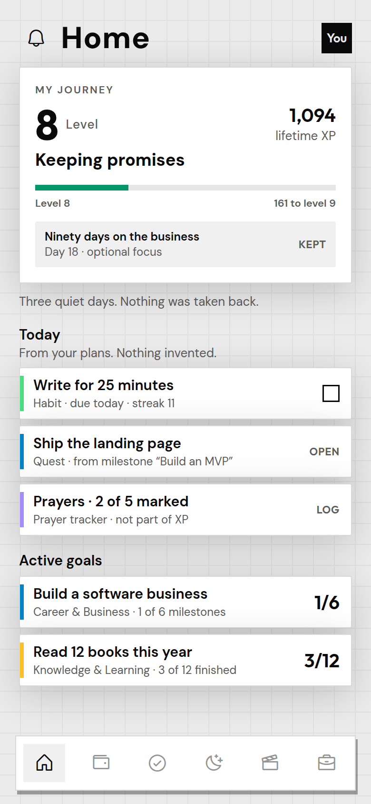
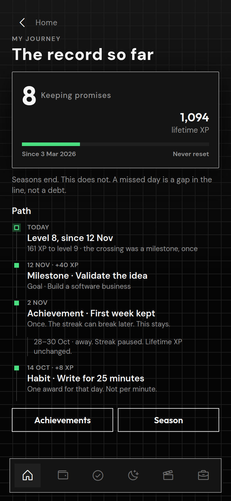
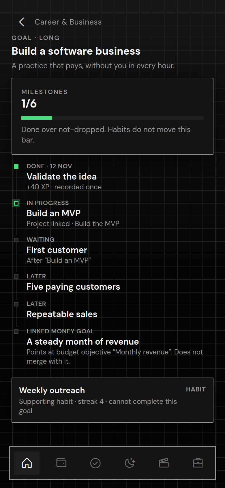
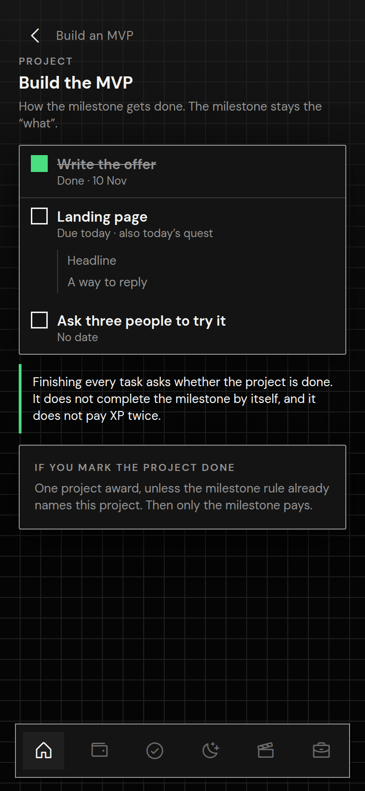
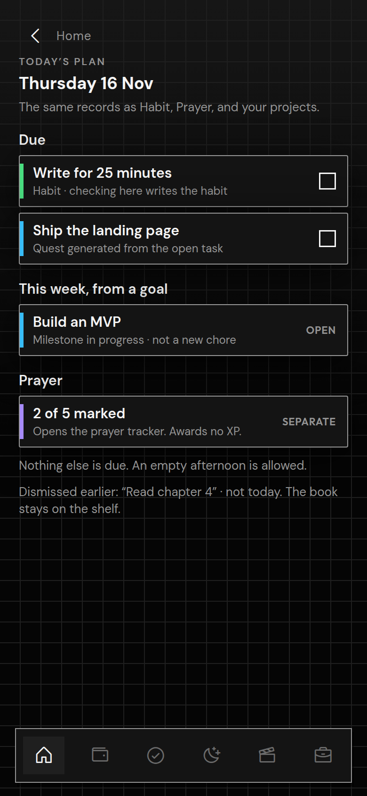
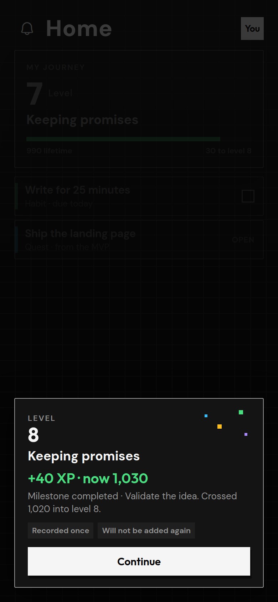
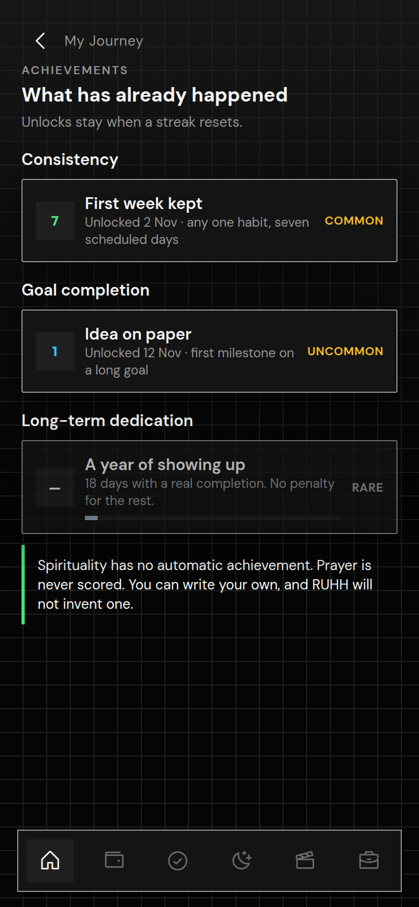
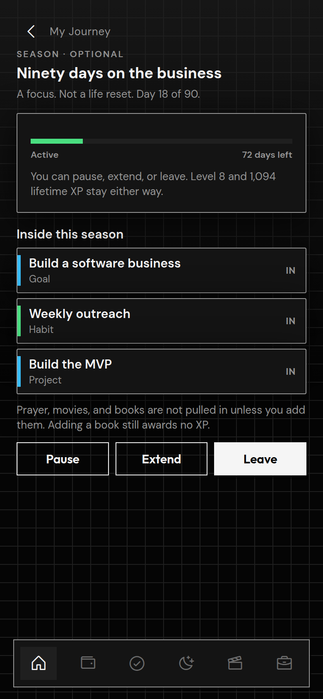
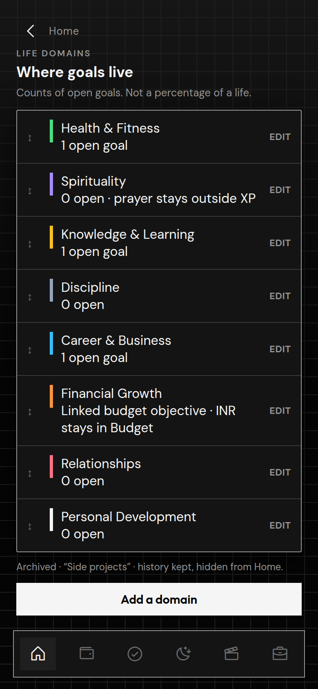

# RUHH Phase 1 frames

Static screens for review. They are not a Flutter build and they are not user data.

Open an `.html` file in `screens/` or look at the PNG next to it. Both themes are drawn from the shipped tokens: desk grid, DM Sans, Outfit, square controls, 2px cards, the module colours in `ruhh/lib/core/theme/nb_colors.dart`. Dark is the product default.

Light frames use a faint ink hairline on white cards. The shipped token `borderHighlight` is white at 55 percent, which disappears on white paper, so the light frame would otherwise have no edge. That adjustment is only in these pictures. It is not an app change.

The sample life is consistent:

- 12 Nov is the level-up moment: 990 XP, then +40 for the milestone "Validate the idea", total 1,030, level 8 because level 8 starts at 1,020.
- 16 Nov is the resting desk: 1,094 lifetime XP, level 8, title "Keeping promises", 161 XP to level 9. The goal "Build a software business" is 1 of 6 milestones.

The curve is `floor(50 * (level - 1) ^ 1.55)` in `RUHH_UX_ARCHITECTURE.md`.

| Frame | Dark | Light |
| --- | --- | --- |
| Home, with My Journey | [png](png/home-dark.png) | [png](png/home-light.png) |
| My Journey detail | [png](png/journey-dark.png) | [png](png/journey-light.png) |
| Goal and milestone timeline | [png](png/goal-dark.png) | [png](png/goal-light.png) |
| Project | [png](png/project-dark.png) | [png](png/project-light.png) |
| Today's plan | [png](png/planner-dark.png) | [png](png/planner-light.png) |
| Level-up | [png](png/levelup-dark.png) | [png](png/levelup-light.png) |
| Achievements | [png](png/achievements-dark.png) | [png](png/achievements-light.png) |
| Season | [png](png/season-dark.png) | [png](png/season-light.png) |
| Domains | [png](png/domains-dark.png) | [png](png/domains-light.png) |

Regenerate HTML with `python3 docs/designs/build_screens.py` from the repo root. PNGs were captured with headless Chrome at 390×844, device scale 2.

DM Sans and Outfit files in `fonts/` are the SIL Open Font License builds from Google Fonts, included so the frames render without a network call. Phosphor is the icon font already in `ruhh/assets/fonts/`.

## Home, dark

## Home, light

## My Journey

## Goal

## Project

## Today's plan

## Level-up

## Achievements

## Season

## Domains

