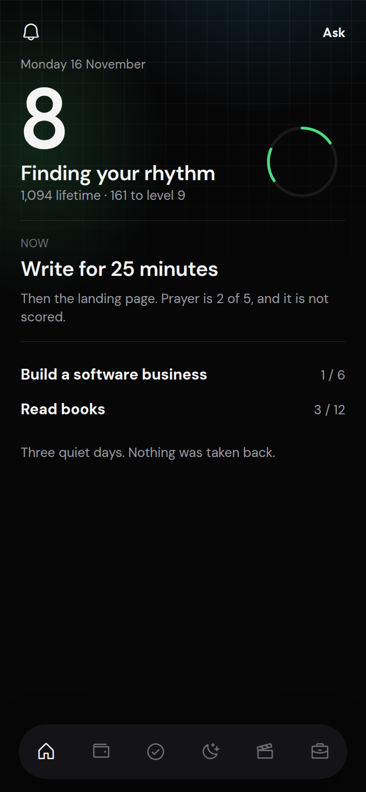
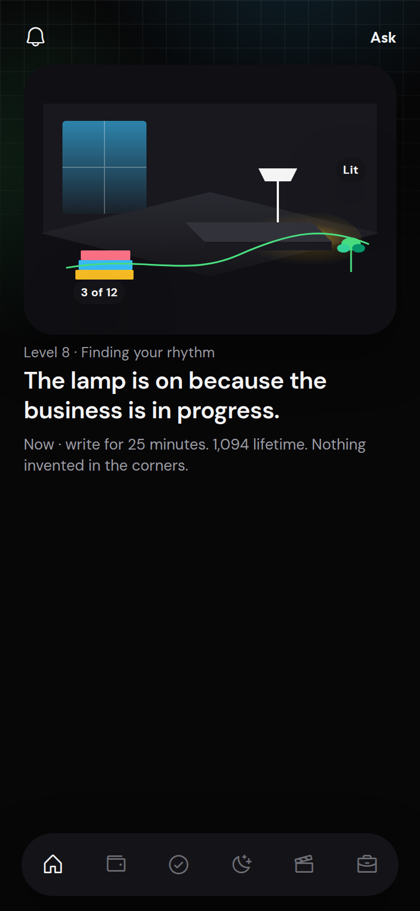
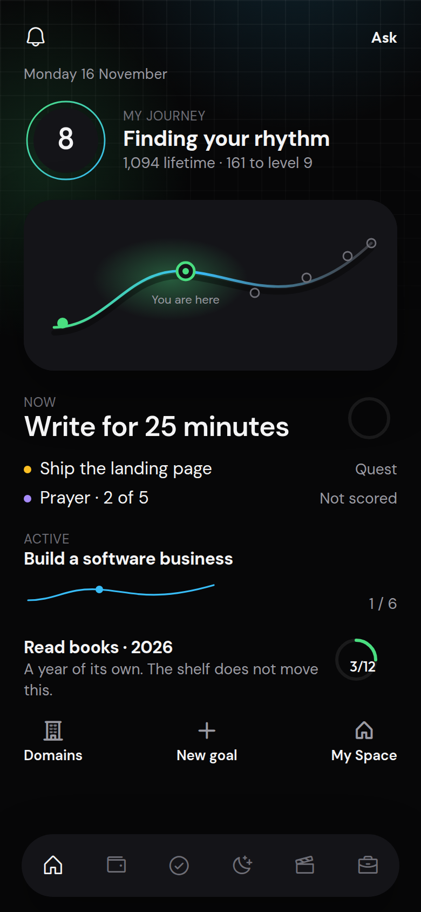
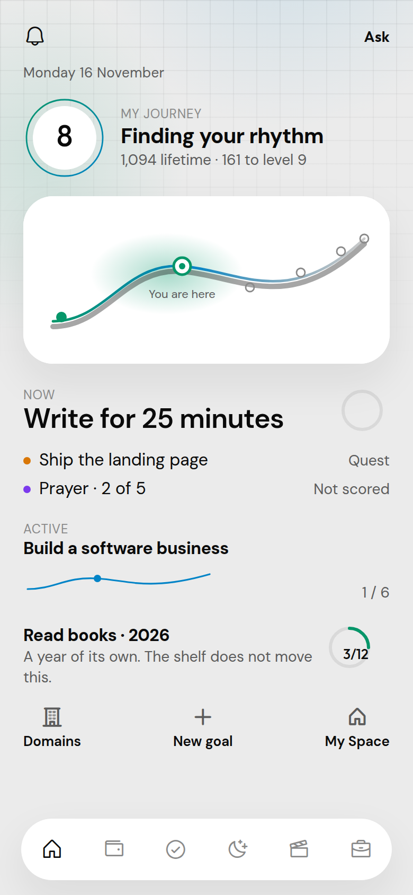
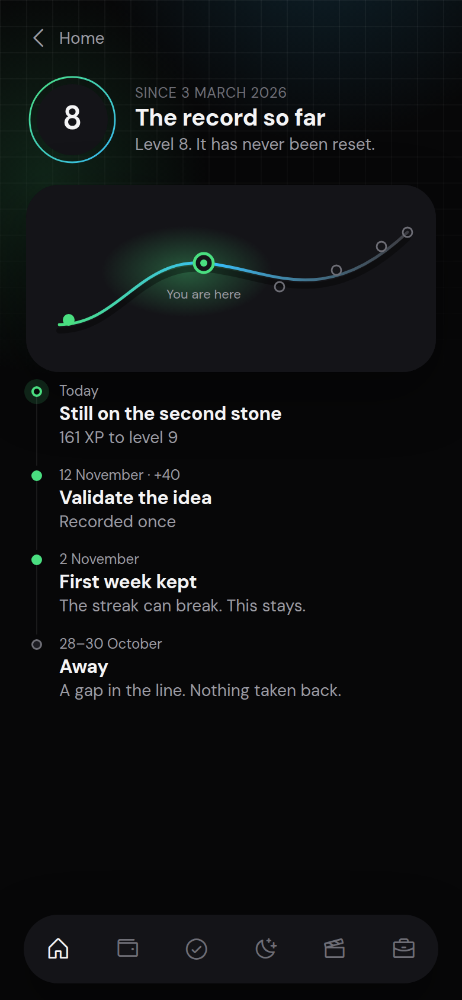
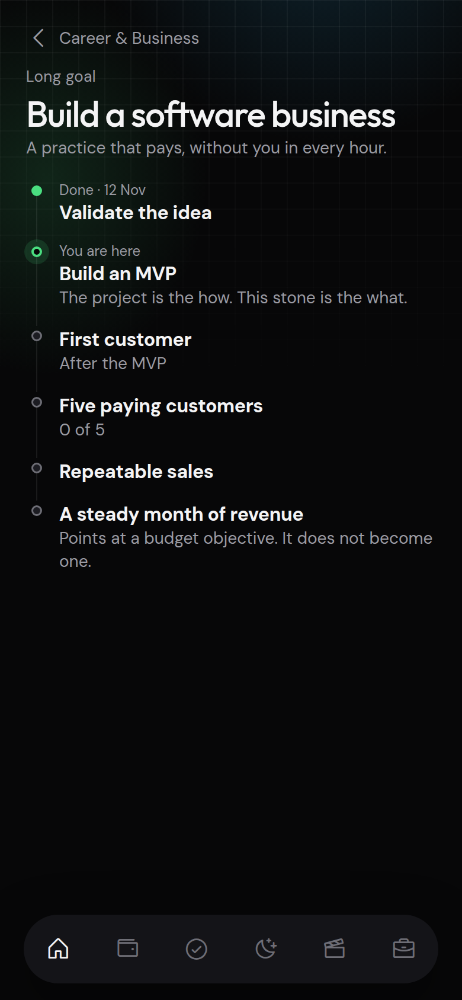
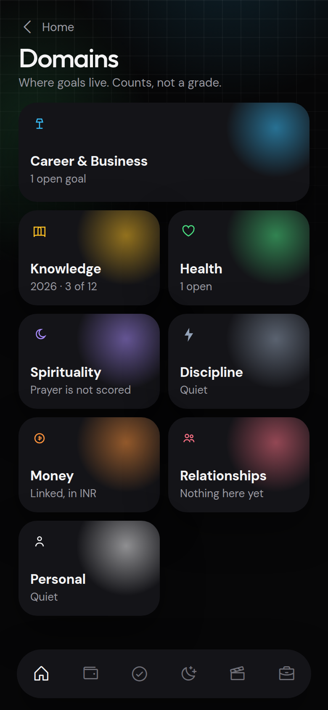
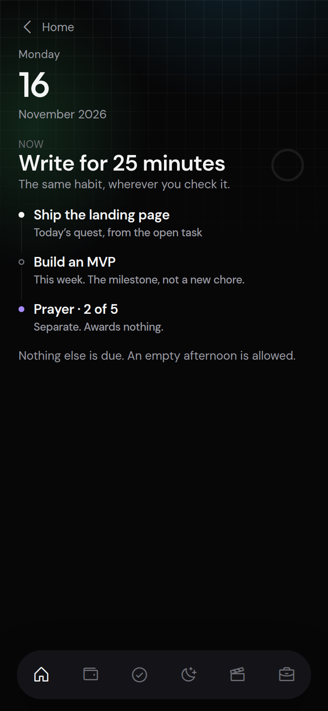
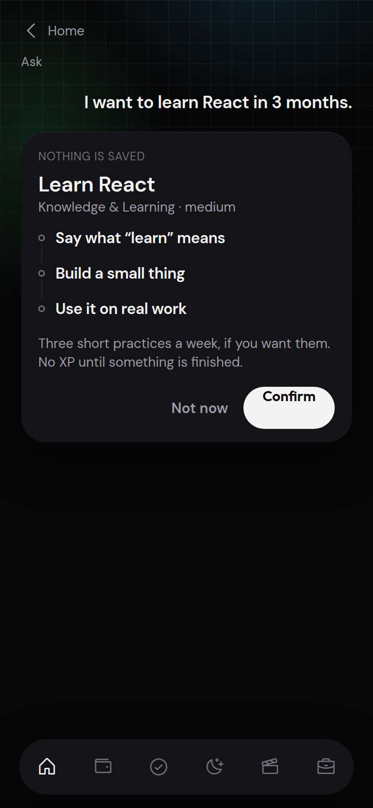
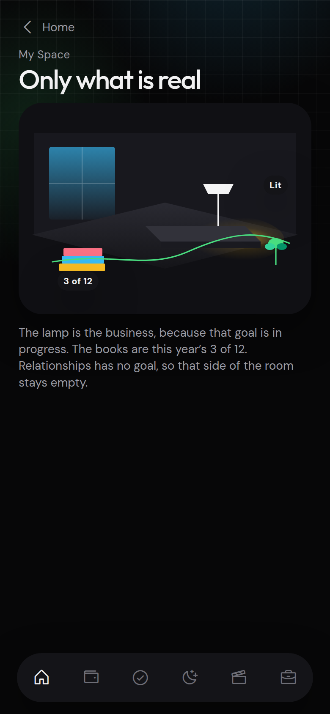

# Visual overhaul frames

Two studies, then the recommended direction. Palette from `RuhhTokens`. Sample life, not user data. Monday 16 November 2026.

Regenerate with `python3 docs/visual/build_visual.py` from the repo root, then capture PNGs from `docs/visual/screens/`.

## Studies (dark)

| | Home | Journey |
| --- | --- | --- |
| A Ambient | [png](png/a-home-dark.png) | [png](png/a-journey-dark.png) |
| B My Space | [png](png/b-home-dark.png) | [png](png/b-journey-dark.png) |

### A — Ambient

### B — My Space

## Recommended — The Lit Desk

| Screen | Dark | Light |
| --- | --- | --- |
| Home | [png](png/home-dark.png) | [png](png/home-light.png) |
| My Journey | [png](png/journey-dark.png) | [png](png/journey-light.png) |
| Goal | [png](png/goal-dark.png) | [png](png/goal-light.png) |
| Domains | [png](png/domains-dark.png) | [png](png/domains-light.png) |
| Planner | [png](png/planner-dark.png) | [png](png/planner-light.png) |
| Ask | [png](png/ask-dark.png) | [png](png/ask-light.png) |
| Achievements | [png](png/achievements-dark.png) | [png](png/achievements-light.png) |
| Season | [png](png/season-dark.png) | [png](png/season-light.png) |
| Create a goal | [png](png/create-dark.png) | [png](png/create-light.png) |
| My Space | [png](png/space-dark.png) | [png](png/space-light.png) |

### Home

### My Journey

### Goal

### Domains

### Planner

### Ask

### My Space

